# Example 01: Prevention (Front Door Application Security Basics)

This lab creates a complete mini-architecture: Front Door Premium, a separately managed Front Door Web Application Firewall Policy in Prevention mode, and a private NGINX application behind a public Standard Load Balancer. Microsoft Default Rule Set 2.2 uses Block action; there are no custom rules or exclusions.

---

## 🧭 Architecture Overview

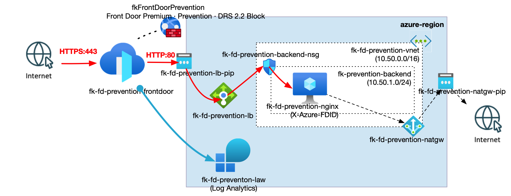

*Figure 1. Front Door Premium with a Front Door Web Application Firewall Policy in Prevention mode (Microsoft DRS 2.2, Block action). HTTPS client traffic reaches the private NGINX backend over HTTP through a public Standard Load Balancer. The backend subnet is protected by an NSG, outbound connectivity uses a NAT Gateway, and Front Door diagnostics are sent to Log Analytics. The policy module owns only the Front Door policy; the pinned Front Door sibling owns delivery and its security association.*

| File | Responsibility |
|---|---|
| `resource_group.tf` | Dedicated lab Resource Group |
| `frontdoor_policy.tf` | Local Front Door policy module |
| `frontdoor.tf` | Front Door v0.1.0, origin, route, association and diagnostics |
| `networks.tf`, `nsg.tf` | VNet, private backend subnet and inbound boundary |
| `nat_gateway.tf` | Explicit backend outbound connectivity |
| `loadbalancers.tf` | Public frontend, backend pool and separate health probe |
| `compute.tf`, `cloud-init-nginx.yaml.tftpl` | Private VM and test application |
| `tls.tf` | Disposable lab SSH key; no private-key output |
| `log_analytics.tf` | Diagnostic workspace |
| `providers.tf`, `variables.tf`, `outputs.tf` | Provider and lab contracts |

| Flow | Boundary / expected behavior |
|---|---|
| Client → Front Door, HTTPS | Managed Front Door rules inspect requests before origin forwarding |
| Front Door → load balancer → NGINX, HTTP 80 | NSG permits `AzureFrontDoor.Backend`; NGINX requires this profile's `X-Azure-FDID` |
| Azure Load Balancer → VM, HTTP 8080 | NSG permits `AzureLoadBalancer`; probe does not require a Front Door header |
| VM → package repositories | NAT Gateway provides outbound connectivity |
| Internet client → origin IP, HTTP 80 | NSG denies direct application access |
| Operator → VM | Azure Run Command; no public VM IP or inbound SSH rule |

Port 8080 has no load-balancing rule and is not published to clients. Azure-provided DNS is used; there are no peerings, custom UDRs or private endpoints. Edge-to-origin HTTP is an educational simplification, not a production end-to-end TLS design.

Front Door backend addresses are shared across customers. The service tag alone is insufficient: the origin also checks the profile GUID, following [Microsoft's origin-security guidance](https://learn.microsoft.com/en-us/azure/frontdoor/origin-security).

---

## 🎯 Why this example exists

This lab demonstrates observable Prevention behavior rather than policy creation alone:

- A benign request reaches a real application.
- A controlled malicious request should be blocked at Front Door and recorded in diagnostics.
- The origin cannot be bypassed through its public load-balancer IP.
- The independently governed Front Door policy is attached by ID through a pinned sibling module.

This is neither an Application Gateway policy nor Azure Firewall. Infrastructure composition belongs only to the lab, not the root policy module.

---

## 🚀 Deployment Steps

```bash
cp terraform.tfvars.example terraform.tfvars
tofu fmt -check
tofu init
tofu validate
```

Set your subscription ID and a globally unique endpoint name. Authenticate externally; never put credentials in tfvars. The lab creates its own Resource Group and billable Front Door Premium, VM, load balancer, NAT Gateway and Log Analytics resources. Review availability and costs before deployment.

For a separately authorized deployment:

```bash
tofu apply -target=module.frontdoor_policy
tofu plan
tofu apply
```

The pinned Front Door v0.1.0 module calculates its association resource count from the policy ID. On a fresh deployment that ID is unknown, causing `Invalid count argument`. The one-time targeted policy bootstrap above resolves this; always follow it with a full apply. Targeting is an exceptional workaround, not the normal workflow for subsequent changes.

Allow time for Front Door propagation, cloud-init and origin health checks. The generated SSH private key is stored in Terraform state: protect state and use this key only for a disposable lab. No private key is committed or exposed as an output.

---

## 🖼️ Azure Portal View

The following Azure Portal screenshots were captured from the deployed lab. Captions describe the visible evidence, not additional checks inferred from the filenames. Subscription IDs are masked in overview images; account identity remains visible in the portal header and should be reviewed before public publication.

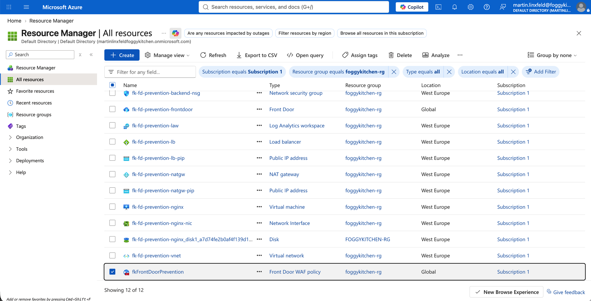

*Figure 2. Resources in the lab Resource Group, including the separate Front Door policy, profile, private backend and networking.*

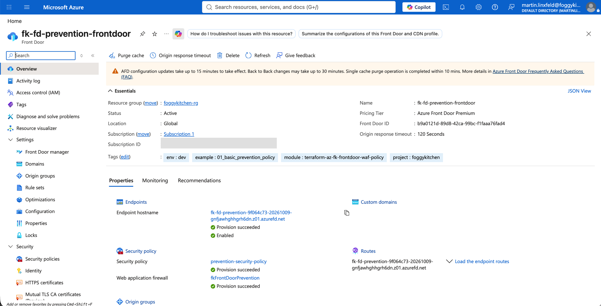

*Figure 3. Active Front Door Premium profile, enabled endpoint and successfully provisioned security policy.*

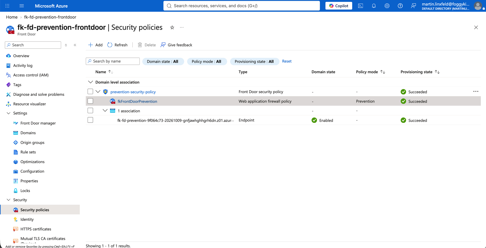

*Figure 4. The Front Door security-policy hierarchy shows the Prevention policy associated with an enabled endpoint.*

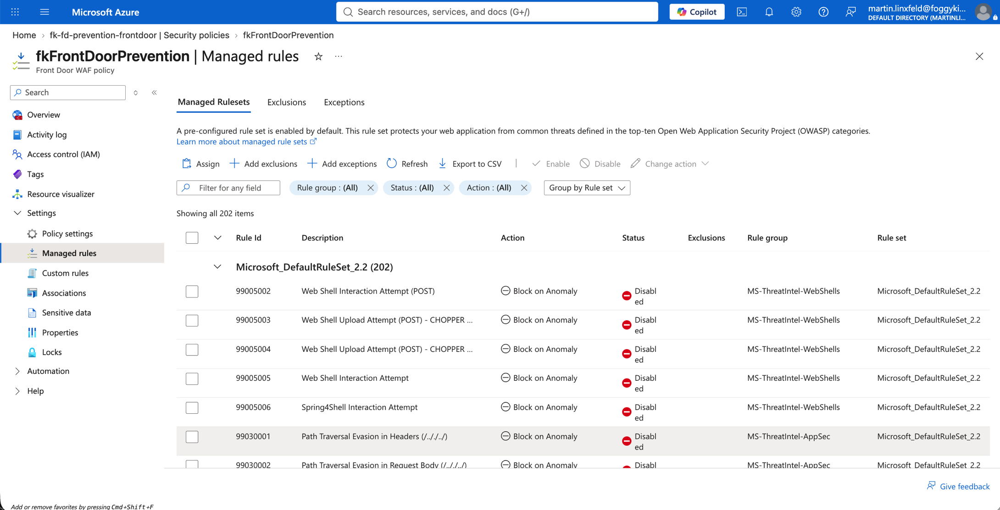

*Figure 5. Microsoft_DefaultRuleSet 2.2 and individual rule states/actions. Some visible rules are Disabled; this image does not establish that every rule is enabled or prove runtime enforcement.*

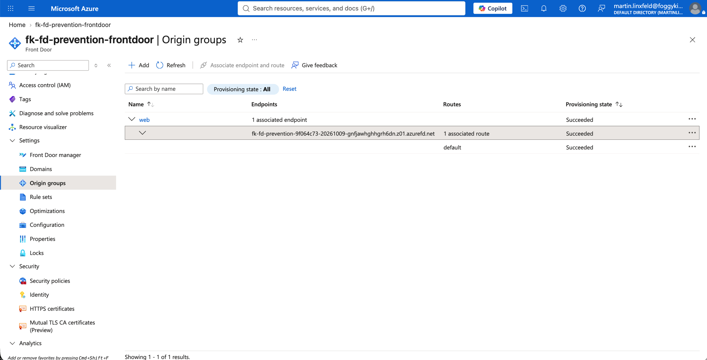

*Figure 6. Origin group `web` is associated with the endpoint and route `default`. Despite its filename, this is an origin-group view, not the Front Door policy-association details.*

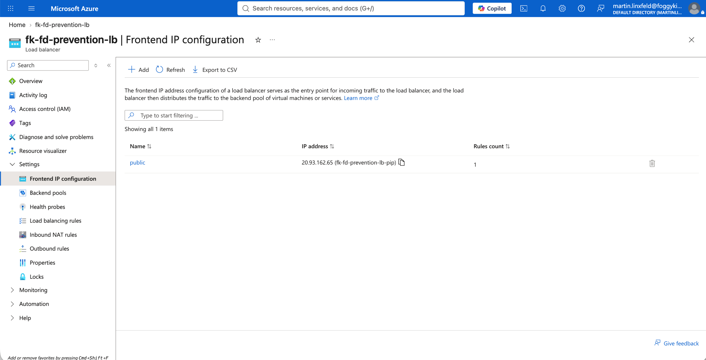

*Figure 7. Public Load Balancer frontend and one configured rule.*

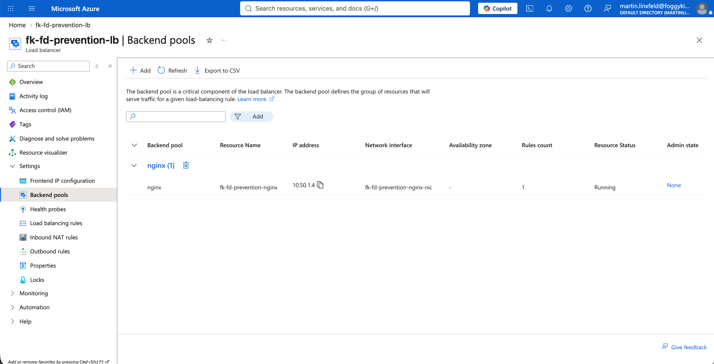

*Figure 8. Backend pool `nginx` contains the running VM at private IP `10.50.1.4`. VM Running status does not establish health-probe success.*

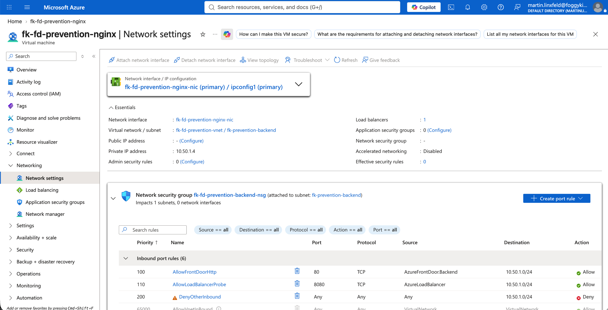

*Figure 9. The VM has no public IP. The subnet NSG permits Front Door on port 80 and Azure Load Balancer probes on port 8080, then denies other inbound traffic.*

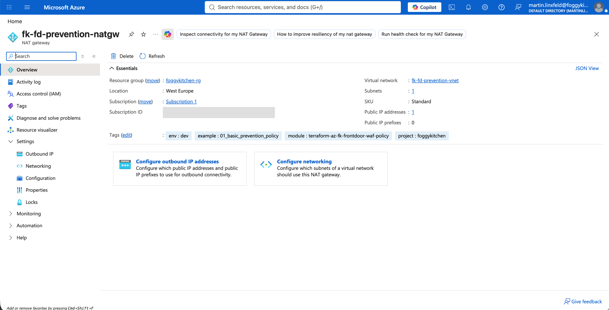

*Figure 10. Standard NAT Gateway associated with one subnet and one public IP.*

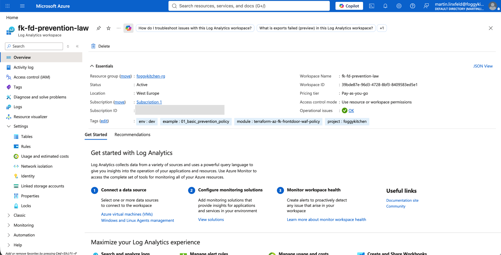

*Figure 11. Active lab Log Analytics workspace. Despite its filename, this is a workspace overview, not a diagnostic-settings view proving log-category routing.*

---

## ✅ Test Results

Static verification on October 9, 2026 with OpenTofu 1.11.6 and AzureRM 4.81.0:

- `tofu fmt -check`: passed
- `tofu init -backend=false -no-color`: passed, including pinned sibling modules
- `tofu validate -no-color`: passed for the complete composition

Deployment was performed on October 9, 2026 with explicit approval: the policy bootstrap added 2 resources, then the full apply added 26 resources, with no changes or deletions. Azure accepted DRS 2.2 and created the Front Door association. The pinned sibling emitted a deprecation warning for its diagnostic `metric` block.

Runtime checks were repeated on October 9, 2026 at approximately 09:33 UTC after the endpoint became operational. The PNG images below are browser screenshots of captured, unmodified CLI command output rendered locally for readability; they are not Azure Portal or terminal-window screenshots. HTML error-page bodies are omitted explicitly. No expected result was substituted for an observed result.

| Check | Observed result | Assessment |
|---|---|---|
| Benign HTTPS request | HTTP 200, `X-FoggyKitchen-Origin: nginx-prevention-lab`, expected application response | Passed |
| Controlled XSS request | HTTP 403, no origin response header | Passed; managed-rule block confirmed in diagnostics |
| Direct public origin access | Connection timeout, curl exit 28 | Consistent with the configured direct-access restriction |
| Managed-rule log correlation | XSS rules 941100, 941110, 941160 matched; blocking evaluation 949110 logged `Block` with the same tracking reference as HTTP 403 | Passed |
| VM readiness | cloud-init done; `nginx -t` successful | Passed |
| Origin without profile header | HTTP 403 | Passed |
| Origin with correct profile header | HTTP 200 | Passed |
| Local health listener on port 8080 | HTTP 200 | Passed; does not itself prove Azure Load Balancer probe metrics |
| Origin access-log correlation | Benign marker count 1; XSS marker count 0 | Benign request reached NGINX; blocked request did not |

Initial requests returned Front Door HTTP 404. They began returning the expected 200/403 without any configuration changes. This is consistent with global configuration propagation: [Microsoft documents](https://learn.microsoft.com/en-us/azure/frontdoor/front-door-faq#what-is-the-estimated-time-for-deploying-an-azure-front-door-does-my-front-door-remain-operational-during-the-update-process) approximately 30 minutes for back-to-back updates. The API still reported `deploymentStatus: NotStarted` while the endpoint was demonstrably serving traffic, so that field alone was not a reliable readiness indicator in this deployment. No policy, NSG or route was weakened to make a test pass.

The test request marker was `prevention-1791538394265-xss`. Its HTTP 403 response and all four managed-rule records shared tracking reference `20261009T093314Z-r1d9499f5f8r5srzhC1WAWzgdn0000001f7g000000002q05`. The individual XSS matches used `AnomalyScoring`; the blocking-evaluation rule `Microsoft_DefaultRuleSet-2.2-BLOCKING-EVALUATION-949110` recorded `Block`. Logs became available after an ingestion delay, so an initially empty query was not treated as a failed diagnostic configuration. Read-back confirmed `allLogs` enabled and the correct workspace destination.

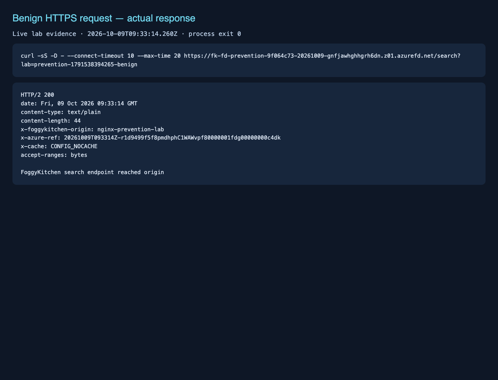

*Figure 12. Benign HTTPS request returns application HTTP 200, the expected response body and the NGINX origin header.*

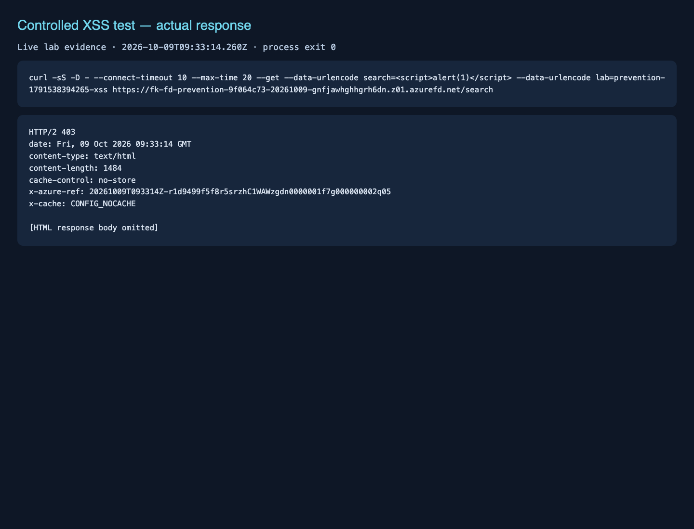

*Figure 13. Controlled XSS-like request returns HTTP 403 without the NGINX origin header. The response tracking reference is used for managed-rule log correlation.*

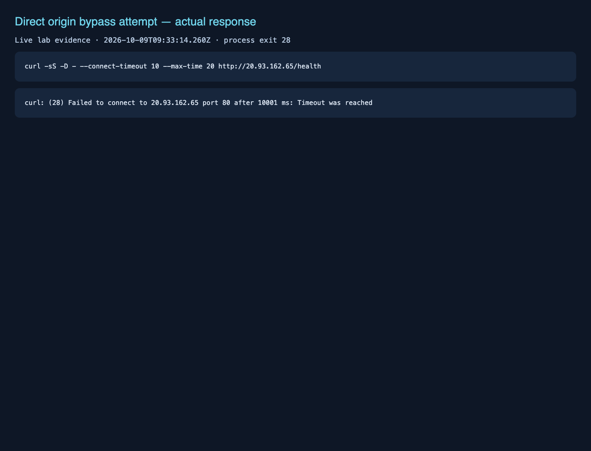

*Figure 14. Direct access to the public origin times out without an HTTP response.*

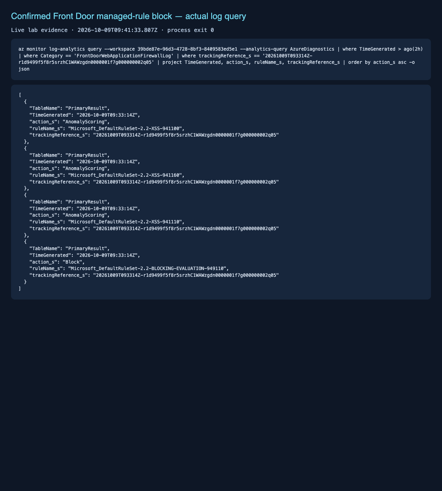

*Figure 15. Three DRS 2.2 XSS matches and the final blocking-evaluation `Block` share the tracking reference from the HTTP 403 response, confirming managed Front Door enforcement.*

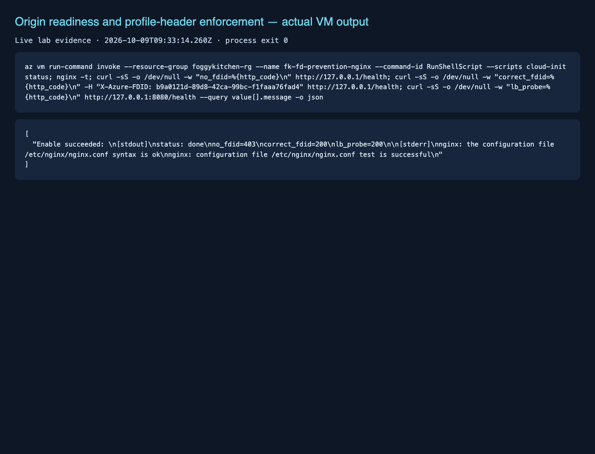

*Figure 16. Azure Run Command confirms NGINX readiness, profile-header enforcement (403/200), and a working local health listener (200).*

Reproduction procedure and expected results:

1. Confirm cloud-init completed, NGINX is running and both health probes are healthy. Use Azure Run Command rather than opening inbound SSH.
2. Test the benign path:

   ```bash
   FRONTDOOR_HOST=$(tofu output -raw frontdoor_endpoint_host_name)
   curl -i "https://${FRONTDOOR_HOST}/health"
   curl -i "https://${FRONTDOOR_HOST}/search?lab=prevention-benign"
   ```

   Expect HTTP 200 and `X-FoggyKitchen-Origin: nginx-prevention-lab`.

3. Send a controlled XSS-like input to this disposable application only:

   ```bash
   curl -i --get \
     --data-urlencode 'search=<script>alert(1)</script>' \
     --data-urlencode 'lab=prevention-xss' \
     "https://${FRONTDOOR_HOST}/search"
   ```

   Expect a managed-rule block, normally HTTP 403, without the origin response header. The origin's `/search` handler otherwise returns a constant 200: it neither evaluates nor reflects the payload.

4. Correlate the request in the lab workspace:

   ```kusto
   AzureDiagnostics
   | where TimeGenerated > ago(1h)
   | where Category == "FrontDoorWebApplicationFirewallLog"
   | extend requestUri=tostring(column_ifexists('requestUri_s', '')),
       action=tostring(column_ifexists('action_s', '')),
       ruleName=tostring(column_ifexists('ruleName_s', '')),
       trackingReference=tostring(column_ifexists('trackingReference_s', ''))
   | where requestUri contains "prevention-xss"
   | project TimeGenerated, action, ruleName, requestUri, trackingReference
   | order by TimeGenerated desc
   ```

   Confirm `Block` and the actual rule responsible. Logs can arrive after a delay. See [Microsoft's rule-tuning guidance](https://learn.microsoft.com/en-us/azure/web-application-firewall/afds/waf-front-door-tuning?pivots=front-door-standard-premium). A 403 alone does not prove a managed Front Door rule blocked the request.

5. Inspect `/var/log/nginx/lab-access.log` through Azure Run Command. The benign marker should appear; the blocked marker should not. Confirm the accepted profile header matches `frontdoor_resource_guid`.
6. Test bypass from your Internet client:

   ```bash
   ORIGIN_IP=$(tofu output -raw origin_public_ip)
   curl -i --connect-timeout 10 --max-time 15 "http://${ORIGIN_IP}/health"
   ```

   Expect no successful HTTP response because the NSG denies your source. Locally on the VM, port 80 without `X-Azure-FDID` should return 403; the correct profile header should return 200. Port 8080 `/health` should remain healthy without that header.

7. Record actual statuses, rule matches, timestamps and screenshots here. Do not mark runtime checks passed until executed.

---

## 🧹 Cleanup

After recording evidence, review and destroy the isolated lab:

```bash
tofu destroy
```

This removes the lab Resource Group and its managed resources, including the association and policy. Do not reuse this lab's policy for external consumers without reviewing lifecycle coupling.

Cleanup was executed on October 9, 2026 after runtime verification and evidence collection:

```text
Destroy complete! Resources: 28 destroyed.
```

Post-cleanup verification: `tofu state list` returned no resources and `az group exists --name foggykitchen-rg` returned `false`. Front Door profile deletion took 15 minutes 31 seconds; the operation was allowed to finish without a concurrent manual delete. The screenshots above are retained evidence from the completed deployment, not currently running resources. Recreate the lab from its configuration to repeat the tests.

---

## 🪪 License

Licensed under the **Universal Permissive License (UPL), Version 1.0**.
See [LICENSE](../../LICENSE) for details.

© 2026 [FoggyKitchen.com](https://foggykitchen.com) - Cloud. Code. Clarity.
