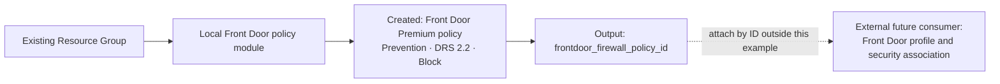

# Example 01: Basic Prevention Policy (Front Door Application Security Basics)

In this first Azure Front Door policy example, we create a standalone **Front Door Premium Web Application Firewall Policy** using **Terraform / OpenTofu**.

Its purpose is to provide the smallest complete, independently governed security artifact: Prevention mode, Microsoft Default Rule Set 2.2 with Block action, and no custom rules.

---

## 🧭 Architecture Overview

The local module creates one global Front Door policy in an existing Resource Group. The policy has no profile dependency and exposes its resource ID for independently managed consumers.



*Figure 1. Standalone Azure Front Door policy ownership and its external attachment boundary. The dotted connection is not created by this example.*

This example creates:

- One `azurerm_cdn_frontdoor_firewall_policy`
- Premium SKU, enabled state and request body inspection
- Prevention mode
- Microsoft Default Rule Set 2.2 with Block action
- Policy ID, name and SKU exposed by the root module

The Resource Group already exists. No Front Door profile, endpoint, origin, route or security-policy association is created. Without an association, the policy cannot inspect traffic.

---

## 🎯 Why this example exists

Before introducing Front Door attachment, custom rules, rate limiting or exclusions, it is useful to understand **the lifecycle of a centrally governed Front Door policy**.

This example focuses on:

- A minimal explicit security baseline
- The Premium requirement for managed rules
- The difference between policy creation and traffic protection
- Policy-ID composition without a profile dependency

Application Gateway policies and Azure Firewall rules use separate modules and resource types.

---

## 🚀 Deployment Steps

For the static checks already performed:

```bash
cp terraform.tfvars.example terraform.tfvars
tofu fmt -check
tofu init
tofu validate
```

Replace the illustrative subscription ID and Resource Group name. Keep credentials outside source control. The policy name must begin with a letter and contain only letters and numbers.

For a later, reviewed deployment:

```bash
tofu plan
tofu apply
```

This example does not create a Resource Group. A deployment checks policy creation and service-side acceptance of DRS 2.2; it does not by itself test HTTP enforcement.

---

## 🖼️ Azure Portal View

Screenshots have not been collected. After deployment, collect the following evidence; filenames follow the sibling repository convention.

| Planned screenshot | Evidence to capture |
|---|---|
| `01_basic_prevention_policy_resource_group_overview.jpg` | The new Front Door policy in the existing Resource Group |
| `01_basic_prevention_policy_policy_overview.jpg` | Front Door Premium tier, Enabled state and Prevention mode |
| `01_basic_prevention_policy_managed_rules.jpg` | Microsoft_DefaultRuleSet 2.2 with Block action |
| `01_basic_prevention_policy_custom_rules.jpg` | Empty custom-rule list |

Redact subscription IDs and unrelated resources before publishing images. Add image links and figure captions only after the files exist.

---

## ✅ Test Results

Static verification completed on October 9, 2026 with OpenTofu 1.11.6 and AzureRM 4.81.0:

- `tofu fmt -check`: passed
- `tofu init -backend=false -no-color`: passed
- `tofu validate -no-color`: passed

No plan, apply or traffic test was run. The root module additionally validates with AzureRM 3.100.0; the example was validated with 4.81.0.

After a future deployment:

1. Confirm successful creation and inspect the actual Azure resource identified by `tofu output -raw frontdoor_firewall_policy_id`.
2. Verify the Premium SKU, Enabled state, Prevention mode, body inspection and DRS 2.2 Block configuration.
3. Confirm there are no custom rules or unintended overrides.
4. Run a post-deployment `tofu plan` and confirm no unexpected changes.
5. Record the date, provider version, actual output and screenshots here.

For enforcement evidence, attach the policy to an isolated Front Door test profile using the composition from example 02. Confirm a benign request reaches the origin and a controlled DRS-triggering request is blocked, with matching Front Door diagnostic evidence. Such an attachment is outside this example's configuration.

---

## 🧹 Cleanup

If consumers were attached separately, detach them before deleting the policy. Destroy only this example's resources:

```bash
tofu destroy
```

The existing Resource Group remains externally managed. Review consumer impact before deleting a shared Front Door policy.

---

## 🪪 License

Licensed under the **Universal Permissive License (UPL), Version 1.0**.
See [LICENSE](../../LICENSE) for details.

© 2026 [FoggyKitchen.com](https://foggykitchen.com) - Cloud. Code. Clarity.
