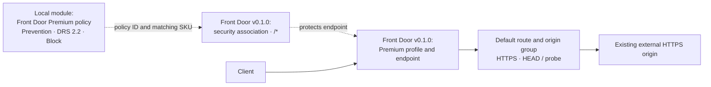

# Example 02: Policy Attached to Front Door (Policy-ID Composition)

In this Azure Front Door example, we compose a standalone **Front Door Premium Web Application Firewall Policy** with the **terraform-az-fk-frontdoor v0.1.0** module using **Terraform / OpenTofu**.

Its purpose is to demonstrate the complete attachment contract: this module owns the security artifact, while the consuming sibling owns the profile, endpoint, origins, route and security-policy association.

---

## 🧭 Architecture Overview

Client requests arrive at the Premium Front Door endpoint. The sibling-owned security association binds the independent policy to that endpoint with `/*`. Requests permitted by the Prevention policy follow the default route to an externally managed HTTPS origin.



*Figure 1. Front Door policy-ID composition and the application traffic path. Dotted edges represent configuration relationships.*

This example creates:

- One independent Front Door Premium policy with DRS 2.2
- One Premium profile and endpoint through terraform-az-fk-frontdoor v0.1.0
- One origin group with an HTTPS `HEAD /` health probe
- One reference to an existing HTTPS origin
- One default route matching `/*`
- One sibling-owned security-policy association named `shared-frontdoor-policy`

The Resource Group and origin application already exist. The origin needs a publicly reachable hostname and a valid matching TLS certificate. The example does not create compute, networking, custom domains or a Log Analytics workspace.

---

## 🎯 Why this example exists

A standalone Front Door policy only protects traffic after attachment. This example makes **the ownership boundary and resource-ID contract** explicit.

This example focuses on:

- Passing `frontdoor_firewall_policy_id` from the local policy module to the pinned sibling
- Passing the policy SKU output to the consuming profile so both use Premium
- Keeping `security_policy_name` independent of the policy name
- Attaching the default endpoint to the policy through `/*`
- Validating the real sibling contract rather than an illustrative resource-ID string

The root policy module continues to create only the Front Door policy.

---

## 🚀 Deployment Steps

For the static checks already performed:

```bash
cp terraform.tfvars.example terraform.tfvars
tofu fmt -check
tofu init
tofu validate
```

Replace the illustrative subscription ID, existing Resource Group name and origin hostname. Supply a globally unique endpoint name. The origin must respond successfully to the configured HTTPS `HEAD /` probe. Credentials remain external.

For a later, reviewed deployment:

```bash
tofu plan
tofu apply
```

Front Door Premium is billable. Use an origin you control for HTTP tests. Diagnostic settings are not configured in this minimal example; prepare an external diagnostic destination before collecting rule-match logs through the sibling's supported diagnostic settings.

---

## 🖼️ Azure Portal View

Screenshots have not been collected. After deployment, collect:

| Planned screenshot | Evidence to capture |
|---|---|
| `02_policy_attached_to_frontdoor_resource_group_overview.jpg` | Independently created Front Door policy and consuming Premium profile |
| `02_policy_attached_to_frontdoor_policy_overview.jpg` | Enabled Prevention policy with Premium SKU |
| `02_policy_attached_to_frontdoor_managed_rules.jpg` | DRS 2.2 with Block action |
| `02_policy_attached_to_frontdoor_frontdoor_overview.jpg` | Premium profile and active default endpoint |
| `02_policy_attached_to_frontdoor_security_policy.jpg` | Association referencing the created policy and protecting the endpoint |
| `02_policy_attached_to_frontdoor_origin_group.jpg` | Configured external origin and HTTPS health probe |
| `02_policy_attached_to_frontdoor_route.jpg` | Enabled default route, endpoint and origin group |
| `02_policy_attached_to_frontdoor_request_evidence.jpg` | Controlled benign and blocked requests, with diagnostic correlation when enabled |

Redact subscription IDs, private hostnames and unrelated resources. Screenshots support the test record; configuration checks and HTTP results establish behavior. Add image links and captions after collecting real files.

---

## ✅ Test Results

Static verification completed on October 9, 2026 with OpenTofu 1.11.6 and AzureRM 4.81.0:

- `tofu fmt -check`: passed
- `tofu init -backend=false -no-color`: passed
- `tofu validate -no-color`: passed

Initialization downloaded the real Front Door v0.1.0 module at commit `ac85f2eb23ddf70e944ab77be784313eb2ede197`. Validation covered both module contracts and the sibling's security-policy resource. Both original Front Door examples also passed validation in an isolated checkout.

No plan, apply or traffic test was run. Static validation does not establish Azure deployment acceptance or runtime enforcement.

After a future deployment:

1. Confirm policy creation and inspect `tofu output -raw frontdoor_firewall_policy_id`.
2. Confirm the deployed `security_policy_id` references that policy and associates the default endpoint with `/*`.
3. Verify both policy and profile use Premium, and the origin health probe succeeds.
4. Wait for configuration propagation and send a benign request to the Front Door hostname:

```bash
FRONTDOOR_HOSTNAME="$(tofu output -raw endpoint_host_name)"
curl --show-error --silent --include "https://${FRONTDOOR_HOSTNAME}/"
```

5. Send a controlled malicious-pattern request against the isolated test origin. Record the HTTP status, timestamp and tracking reference; correlate the managed-rule match in diagnostics. A response status alone does not prove the Front Door policy caused the block.
6. Confirm permitted requests reach the origin and the blocked request does not.
7. Run a post-deployment `tofu plan` and confirm no unexpected changes.
8. Record actual outputs, dates and screenshots here.

Do not treat the illustrative `origin.example.com` value as a working application or a test target.

---

## 🧹 Cleanup

The example contains the association and policy in the same dependency graph. Destroy its created resources after testing:

```bash
tofu destroy
```

Front Door Premium is billable. The existing Resource Group and origin application remain externally managed. If another consumer references the shared policy, detach it before destroying this example.

---

## 🪪 License

Licensed under the **Universal Permissive License (UPL), Version 1.0**.
See [LICENSE](../../LICENSE) for details.

© 2026 [FoggyKitchen.com](https://foggykitchen.com) - Cloud. Code. Clarity.
