# Example 02: One Front Door Policy, Two Independent Applications

In this Azure example, we deploy two **Front Door Premium profiles**, each delivering its own private NGINX application, and attach one shared **Front Door Web Application Firewall Policy** through **terraform-az-fk-frontdoor v0.1.0**.

This is a complete, independent mini-architecture. It needs no existing origin or Resource Group. The root module still creates only the Front Door policy: delivery and security associations belong to the pinned sibling module.

---

## 🧭 Architecture Overview

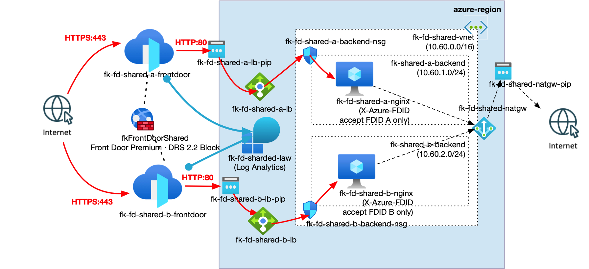

*Figure 1. Two independent Front Door Premium profiles share the `fkFrontDoorShared` Front Door Web Application Firewall Policy in Prevention mode with Microsoft DRS 2.2 and Block action. Each profile forwards requests through its own public Standard Load Balancer to a private NGINX VM in a separate backend subnet. Subnet NSGs restrict application ingress to Front Door backend traffic, and each NGINX accepts only its own profile's `X-Azure-FDID`. Both applications share a NAT Gateway for outbound connectivity, while both profiles send diagnostics to one Log Analytics workspace. Red arrows show application traffic, blue arrows show diagnostics, and dashed black arrows show policy associations and outbound connectivity.*

The lab creates one Resource Group, one global Front Door policy, two Premium profiles/endpoints/security associations, two public Standard Load Balancers, two private VMs with separate disposable SSH keys, two backend subnets/NSGs, one NAT Gateway and one Log Analytics workspace.

Each association protects its own default endpoint with `/*`. Both profiles and the shared policy use `Premium_AzureFrontDoor`. They are in the same subscription, as required by the [Front Door policy FAQ](https://learn.microsoft.com/en-us/azure/web-application-firewall/afds/waf-faq). Managed rules require Premium.

Origins combine the `AzureFrontDoor.Backend` service tag with an application-specific `X-Azure-FDID` check, following [Microsoft's origin-security guidance](https://learn.microsoft.com/en-us/azure/frontdoor/origin-security). NGINX A does not accept profile B's identifier, or vice versa. Sharing security configuration does not share origin authorization.

| Source | Destination | Protocol/port | Expected path and control |
|---|---|---|---|
| Client | Endpoint A or B | HTTPS/443 | Corresponding Front Door profile; shared Prevention policy |
| Front Door A or B | Corresponding NGINX | HTTP/80 | Its public LB → subnet NSG → matching FDID check |
| Azure Load Balancer | Its VM health listener | HTTP/8080 | NSG allows `AzureLoadBalancer`; `/health` needs no FDID |
| Private VMs | Package repositories | TCP/80,443 | Azure system routes and shared NAT Gateway |
| Internet / other backend subnet | NGINX application listener | TCP/80 | Denied by NSG; no inbound SSH |
| Wrong or missing profile identifier | Local NGINX listener | HTTP/80 | Rejected with 403 by NGINX |

Azure-provided DNS resolves package repositories; endpoint DNS is managed by Front Door. There are no UDRs, peering, Private Endpoints, gateways, Application Gateway policies or Azure Firewall resources. Responses to inbound LB flows use the LB return path; NAT provides new outbound connections, not application ingress. Management uses Azure Run Command.

Client-to-edge traffic is HTTPS; edge-to-origin traffic is HTTP for this educational lab, not production end-to-end TLS. Port 8080 has no public LB rule. Default outbound NSG rules are retained for VM bootstrap and Azure management.

---

## 🎯 Why this example exists

Example 01 demonstrates enforcement on one application. This example demonstrates **central Front Door policy governance across two independently configured delivery profiles**.

- One policy ID is consumed twice; there is no duplicated Front Door policy.
- Profiles, routes, origins and associations stay in the Front Door sibling.
- Separate responses identify which application handled a request.
- Shared diagnostics allow comparison without merging origin trust boundaries.
- A policy change affects both applications: review its shared blast radius before tuning.

The root policy module creates neither Front Door delivery resources nor associations. This lab composes focused modules directly; it is not a landing-zone blueprint or orchestrator.

Pinned modules, re-verified live on October 9, 2026:

| Module | Tag |
|---|---|
| [Front Door](https://github.com/foggykitchen/terraform-az-fk-frontdoor/tree/v0.1.0) | v0.1.0 |
| [VNet](https://github.com/foggykitchen/terraform-az-fk-vnet/tree/v0.1.2) | v0.1.2 |
| [NSG](https://github.com/foggykitchen/terraform-az-fk-nsg/tree/v1.0.1) | v1.0.1 |
| [NAT Gateway](https://github.com/foggykitchen/terraform-az-fk-natgw/tree/v1.1.1) | v1.1.1 |
| [Load Balancer](https://github.com/foggykitchen/terraform-az-fk-loadbalancer/tree/v1.2.1) | v1.2.1 |
| [Compute](https://github.com/foggykitchen/terraform-az-fk-compute/tree/v0.4.1) | v0.4.1 |
| [Log Analytics](https://github.com/foggykitchen/terraform-az-fk-log-analytics/tree/v1.0.0) | v1.0.0 |

Configuration is split into `frontdoor_policy.tf`, `frontdoor.tf`, `applications.tf`, `resource_group.tf`, `networks.tf`, `nsg.tf`, `nat_gateway.tf`, `loadbalancers.tf`, `compute.tf`, `tls.tf` and `log_analytics.tf`. The cloud-init template installs and configures the applications.

---

## 🚀 Deployment Steps

Prerequisites: OpenTofu, Azure CLI authentication and permissions, and `curl`/`jq` for tests. The two Premium profiles, NAT Gateway, public IPs, VMs and diagnostics are billable.

```bash
cp terraform.tfvars.example terraform.tfvars
# Edit subscription_id and both globally unique endpoint_names.
tofu fmt -check
tofu init
tofu validate
```

Use a dedicated, absent Resource Group; this configuration creates it. Credentials stay external. The fixed subnet prefixes do not overlap. If composing with existing networks, review address overlap first.

### First deployment: policy bootstrap

The pinned [Front Door v0.1.0 source](https://github.com/foggykitchen/terraform-az-fk-frontdoor/blob/v0.1.0/main.tf) uses `count = var.frontdoor_firewall_policy_id == null ? 0 : 1` for its association. A newly created policy ID is unknown during the first full plan, so that plan can fail with `Invalid count argument`. Static validation cannot detect this.

As in example 01, create the policy first so its ID is known:

```bash
tofu plan -target=module.frontdoor_policy
tofu apply -target=module.frontdoor_policy
tofu plan
tofu apply
```

This is a one-time compatibility workaround, not routine targeted deployment. It creates the Resource Group dependency too. Subsequent changes use normal full plans/applies. No sibling source is modified.

Front Door deployment and global propagation take time. Transient 404 responses immediately after provisioning are not proof of broken routing. Wait and inspect profile, endpoint, route and probe states before changing configuration. [Microsoft's FAQ](https://learn.microsoft.com/en-us/azure/frontdoor/front-door-faq) describes approximately 15 minutes for individual changes and about 30 minutes for back-to-back changes. Example 01 demonstrated this delay in practice. Diagnostic ingestion can also lag.

---

## 🖼️ Azure Portal View

Actual Azure Portal screenshots from the deployed lab:

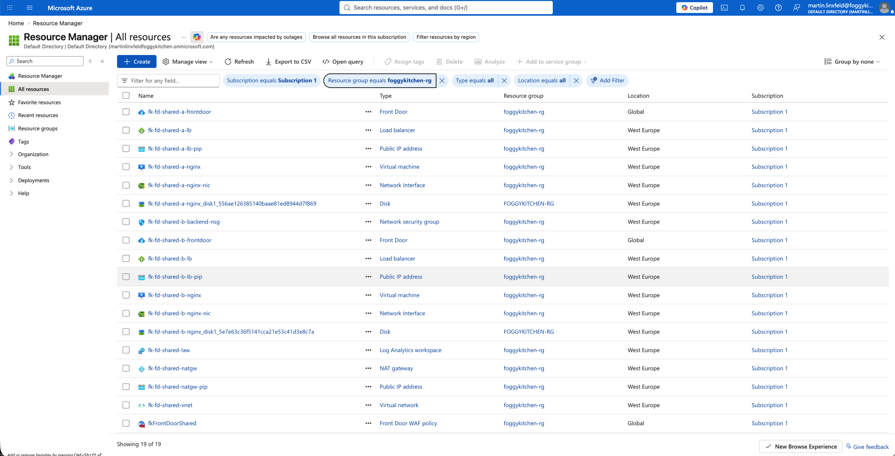

*Figure 2. Resources from both independent application delivery paths and the shared Front Door policy in the lab Resource Group.*

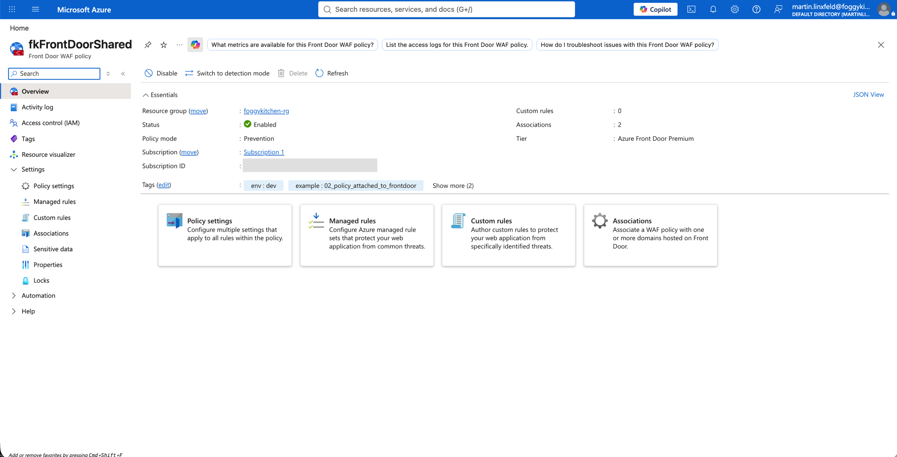

*Figure 3. The shared Front Door policy is Enabled, runs in Prevention mode, uses Azure Front Door Premium and has two associations.*

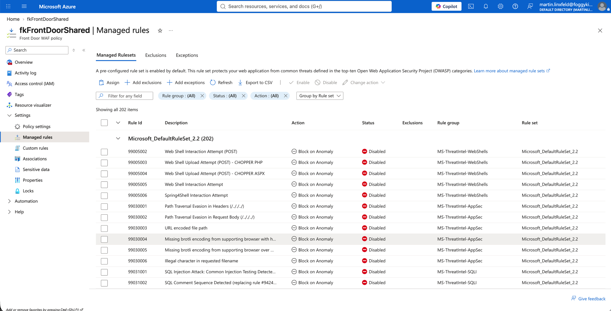

*Figure 4. Microsoft_DefaultRuleSet 2.2 and individual rule states/actions. Some visible rules are Disabled; this screenshot alone neither proves every rule is enabled nor establishes runtime enforcement.*

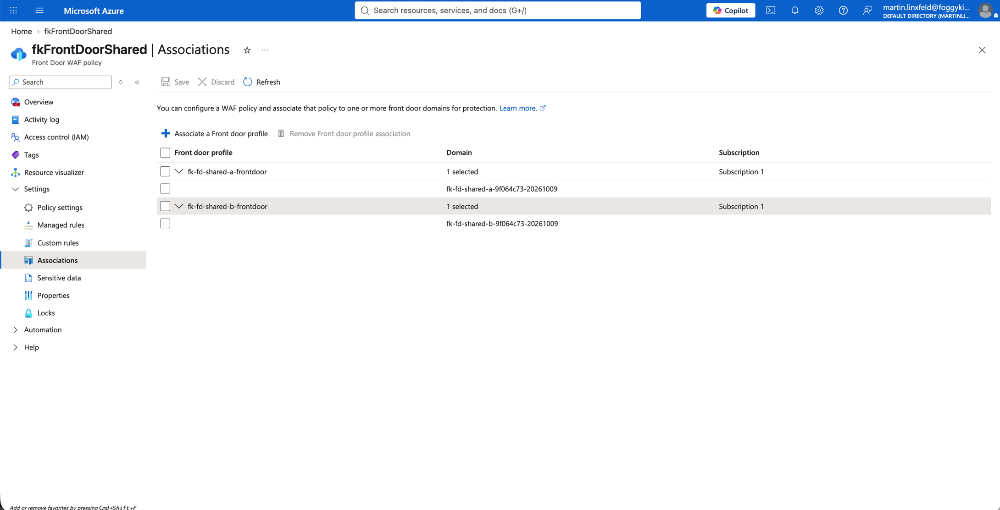

*Figure 5. One Front Door policy is associated with both profiles and their separate default endpoints.*

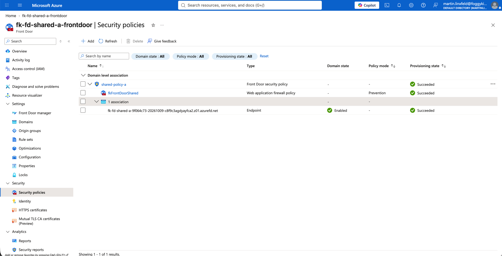

*Figure 6. Profile A's security association references fkFrontDoorShared in Prevention mode and protects its enabled endpoint; provisioning reports Succeeded.*


*Figure 7. Profile B independently references the same Front Door policy and protects its own enabled endpoint; provisioning reports Succeeded.*

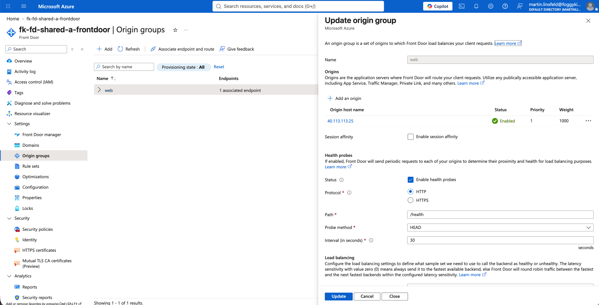

*Figure 8. Profile A's origin group web references its own enabled Load Balancer origin at 40.113.113.25. The configured probe is HTTP HEAD /health every 30 seconds; this configuration view is not a probe-health result.*

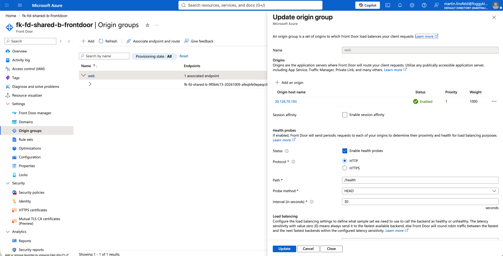

*Figure 9. Profile B's origin group web references the distinct enabled origin at 20.126.70.193 and uses the same HTTP HEAD /health probe configuration.*

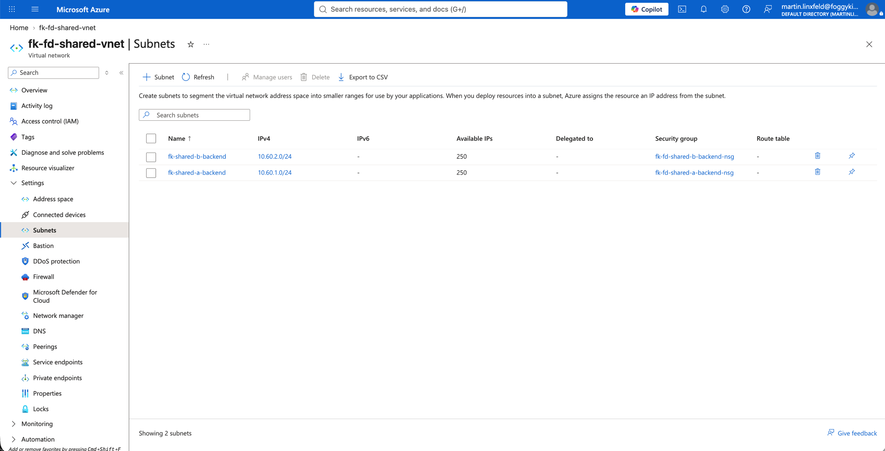

*Figure 10. Separate backend subnets fk-shared-a-backend (10.60.1.0/24) and fk-shared-b-backend (10.60.2.0/24), each associated with its own NSG.*

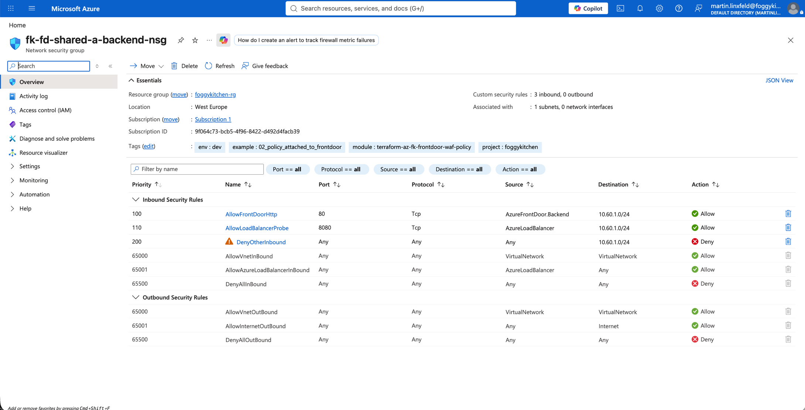

*Figure 11. Application A's NSG permits AzureFrontDoor.Backend on TCP/80 and AzureLoadBalancer on TCP/8080, then denies other inbound traffic to its subnet.*


*Figure 12. Application B has the same restrictive inbound rules in its independent subnet NSG.*

---

## ✅ Test Results

Static verification of the expanded lab passed on October 9, 2026 with OpenTofu 1.11.6, AzureRM 4.81.0, TLS 4.4.1 and the compute module's Null 3.3.2 dependency:

- `tofu fmt -check`: passed
- `tofu init -backend=false -no-color`: passed; real pinned sibling modules downloaded
- `tofu validate -no-color`: passed, including both Front Door module instances and their association contracts

### Deployment record — October 9, 2026

The lab was deployed with explicit approval using the subscription, Resource Group (`foggykitchen-rg`) and region (`westeurope`) from example 01's ignored local tfvars. Both endpoint names were changed for this independent lab. AzureRM 4.81.0 was used.

```text
Policy bootstrap:
Apply complete! Resources: 2 added, 0 changed, 0 destroyed.

Full deployment:
Apply complete! Resources: 46 added, 0 changed, 0 destroyed.
```

All 48 managed resources were created. Both security-policy associations report `Succeeded` and reference the same `fkFrontDoorShared` Front Door policy ID. The private VM addresses are `10.60.1.4` and `10.60.2.4`.

The first HTTPS requests at approximately 11:07 UTC, and an initial test at 11:26 UTC, returned Front Door HTTP 404 with `CONFIG_NOCACHE` on both endpoints. Both `/health` endpoints returned 200 by 11:30:16 UTC, approximately 25 minutes after the full apply completed. No route, policy, NSG or origin configuration was changed to obtain this result. The exact transition time was not continuously observed.

The post-deployment full plan, repeated after the runtime tests, completed with exit code 2: `0 to add, 2 to change, 0 to destroy`. Both differences concern only `log_analytics_destination_type`: the plan proposes restoring `AzureDiagnostics` on the two diagnostic settings. Read-back returns `null`, which [Azure Monitor documents as the default AzureDiagnostics destination](https://learn.microsoft.com/en-us/rest/api/monitor/diagnostic-settings/list?view=rest-monitor-2021-05-01-preview). The observed plan differences are consistent with API/provider normalization; they do not establish failed log delivery. This is not a clean/no-drift result, and no corrective apply has been performed. The sibling also emits its documented `metric` deprecation warning.

### Runtime verification — October 9, 2026

The final HTTP test requests were sent at 11:45:32 UTC with marker `shared-1791546331492`. Azure Run Command checked both VMs and their access logs between 11:45 and 11:47 UTC. Correlated managed-rule records for both profiles were confirmed by 11:47:18 UTC.

| Check | Application A | Application B | Assessment |
|---|---|---|---|
| Shared Front Door policy attachment | `Succeeded`, active endpoint, `/*` | `Succeeded`, active endpoint, `/*` | Both reference `fkFrontDoorShared` |
| Benign HTTPS request | 200; `nginx-shared-A-lab` | 200; `nginx-shared-B-lab` | Passed; distinct application responses |
| Controlled XSS request | 403; no origin header | 403; no origin header | HTTP blocking observed on both; log correlation recorded separately |
| Managed-rule correlation | 941100, 941110, 941160: `AnomalyScoring`; 949110: `Block` | Same | Passed; exact response tracking reference and profile matched on both |
| Direct public origin access | curl exit 28, connection timeout | curl exit 28, connection timeout | Consistent with direct-origin restriction |
| VM readiness | cloud-init done; NGINX active; configuration test successful | Same | Passed |
| Own profile FDID on local listener | 200 | 200 | Passed |
| Other profile FDID on local listener | 403 | 403 | Passed |
| Missing FDID on local listener | 403 | 403 | Passed |
| Local health listener on 8080 | 200 | 200 | Passed; not a standalone Azure LB probe-metrics test |
| Origin marker correlation | benign count 1; XSS count 0 | benign count 1; XSS count 0 | Allowed request reached its VM; blocked request did not |
| Diagnostic settings read-back | `allLogs` enabled; correct shared workspace | Same | Passed; ingestion can lag independently per profile |

The blocked requests used these actual `X-Azure-Ref` values:

```text
A: 20261009T114532Z-r1d9499f5f8mk4kwhC1WAWepf00000000ung000000014cw7
B: 20261009T114532Z-r1d9499f5f87fzbshC1WAWe1zg0000001fsg00000000h645
```

Selected actual HTTP and VM outputs:

```text
Application A:
HTTP/2 200
x-foggykitchen-origin: nginx-shared-A-lab
FoggyKitchen application A search reached origin

Application B:
HTTP/2 200
x-foggykitchen-origin: nginx-shared-B-lab
FoggyKitchen application B search reached origin

Controlled XSS: HTTP/2 403 on A and B; neither response included the origin header.
Direct origins: curl exit 28 on 40.113.113.25 and 20.126.70.193.

Both VMs, via Azure Run Command:
status: done
active
own=200
other=403
missing=403
probe=200
nginx: configuration file /etc/nginx/nginx.conf test is successful

Both origin access logs:
benign_count=1
xss_count=0
```

The benign NGINX entries at `2026-10-09T11:45:32+00:00` contain `status=200`, the corresponding profile FDID and the same tracking reference as their benign HTTP response. The local wrong-FDID test proves NGINX's header guard; it is not a live route-switching test through the other profile. No inbound SSH or direct-origin exception was introduced.

The first operational run at 11:30 confirmed HTTP blocking on both profiles, but only B's correlated records were observed during that monitoring window. The complete test was repeated with fresh markers at 11:45; both profiles' records were then confirmed without changing infrastructure or weakening ingress restrictions.

The test screenshots below are browser screenshots of actual CLI outputs rendered locally, as in example 01. They are not Azure Portal or terminal-window screenshots. Azure Run Command JSON messages are decoded for readability; HTML error-page bodies are explicitly omitted. No expected response is substituted for an observed response.

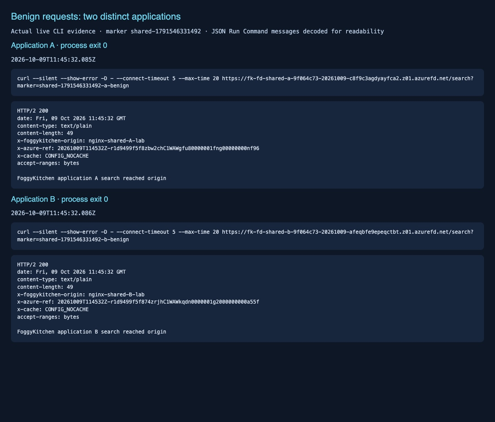

*Figure 13. Both Front Door endpoints return HTTP 200 with distinct NGINX origin headers and application A/B response bodies.*

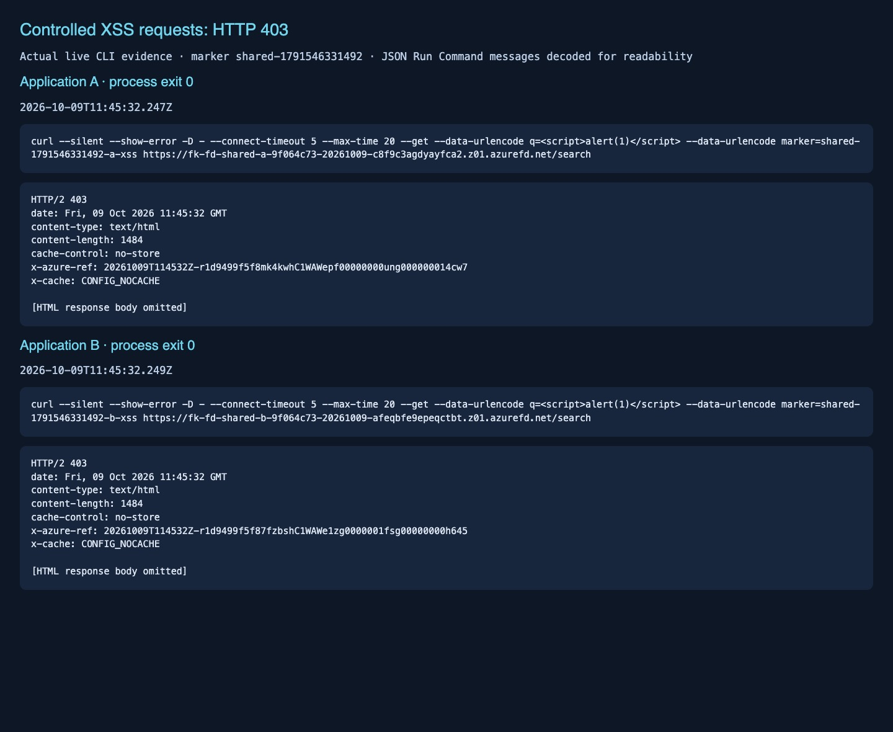

*Figure 14. Controlled XSS requests return HTTP 403 on both endpoints without an NGINX origin header. The response tracking references are used for managed-rule log correlation.*

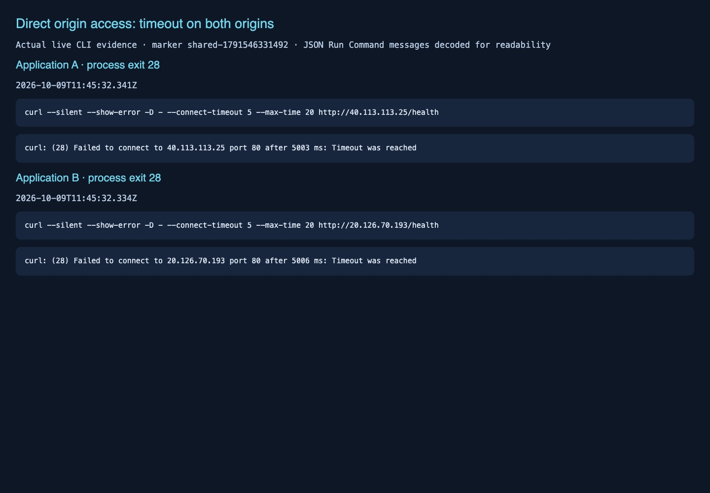

*Figure 15. Direct requests to both public origin IPs time out with curl exit 28; neither returns an application response.*

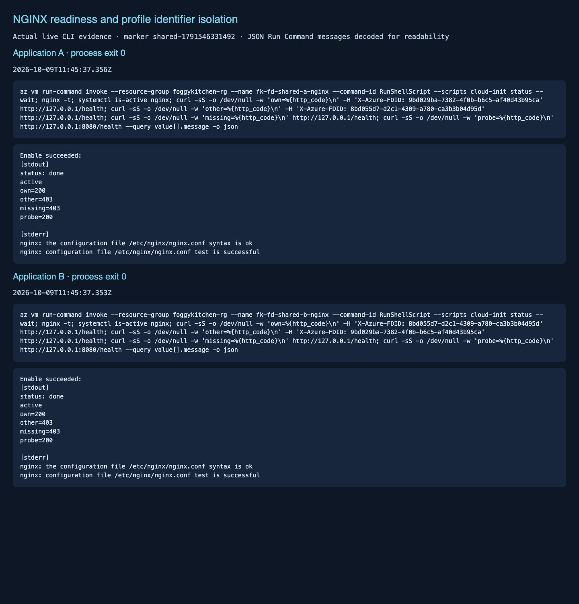

*Figure 16. Both VMs report completed cloud-init and a valid, active NGINX configuration. Each local application listener accepts its own profile FDID (200), rejects the other profile and missing FDID (403), and exposes a working local health listener on 8080 (200).*

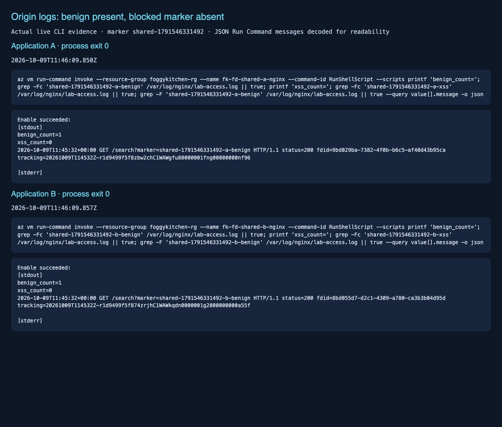

*Figure 17. Each NGINX access log contains its own benign marker once and no entry for its blocked XSS marker; the accepted request includes the expected profile FDID and tracking reference.*

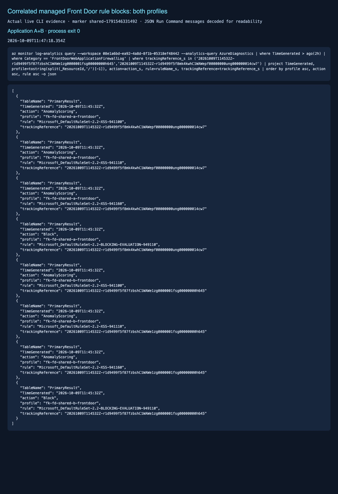

*Figure 18. Log Analytics records match each profile and the exact HTTP 403 tracking reference from Figure 14. Both profiles report three XSS anomaly-scoring matches followed by rule 949110 with action Block.*

Actual records have `TimeGenerated=2026-10-09T11:45:32Z`. Each application's records carry its corresponding tracking reference shown above:

| Profile | Rule | Action |
|---|---|---|
| fk-fd-shared-a-frontdoor | Microsoft_DefaultRuleSet-2.2-XSS-941100 | AnomalyScoring |
| fk-fd-shared-a-frontdoor | Microsoft_DefaultRuleSet-2.2-XSS-941110 | AnomalyScoring |
| fk-fd-shared-a-frontdoor | Microsoft_DefaultRuleSet-2.2-XSS-941160 | AnomalyScoring |
| fk-fd-shared-a-frontdoor | Microsoft_DefaultRuleSet-2.2-BLOCKING-EVALUATION-949110 | Block |
| fk-fd-shared-b-frontdoor | Microsoft_DefaultRuleSet-2.2-XSS-941100 | AnomalyScoring |
| fk-fd-shared-b-frontdoor | Microsoft_DefaultRuleSet-2.2-XSS-941110 | AnomalyScoring |
| fk-fd-shared-b-frontdoor | Microsoft_DefaultRuleSet-2.2-XSS-941160 | AnomalyScoring |
| fk-fd-shared-b-frontdoor | Microsoft_DefaultRuleSet-2.2-BLOCKING-EVALUATION-949110 | Block |

### Reproduction procedure

The following commands reproduce the checks; their expected results are separate from the observed record above.

### 1. Verify the shared attachment

```bash
RG="$(tofu output -raw resource_group_name)"
POLICY_ID="$(tofu output -raw frontdoor_firewall_policy_id)"
APPS="$(tofu output -json applications)"
for app in a b; do
  PROFILE="$(printf '%s' "$APPS" | jq -r --arg app "$app" '.[$app].profile_name')"
  az afd security-policy show --resource-group "$RG" --profile-name "$PROFILE" \
    --security-policy-name "shared-policy-$app" \
    --query '{policy:parameters.wafPolicy.id,associations:parameters.associations}' -o json
done
printf 'Expected identical policy ID: %s\n' "$POLICY_ID"
```

Both associations must reference `POLICY_ID`, protect their own endpoint with `/*`, and use Premium profiles. Verify neither application's origin points to the other LB.

### 2. Benign and controlled XSS requests

Run only against these lab endpoints. Use unique markers to distinguish requests from probes and earlier tests.

```bash
MARKER="fk-shared-$(date -u +%Y%m%dT%H%M%SZ)"
for app in a b; do
  HOST="$(printf '%s' "$APPS" | jq -r --arg app "$app" '.[$app].endpoint_host_name')"
  curl --silent --show-error --include --max-time 30 \
    "https://$HOST/search?marker=$MARKER-$app-benign"
  curl --silent --show-error --include --max-time 30 --get \
    --data-urlencode "marker=$MARKER-$app-xss" \
    --data-urlencode 'q=<script>alert(1)</script>' "https://$HOST/search"
done
```

Expect benign HTTP 200 with the corresponding application identity; XSS should return 403. Record UTC timestamps and `X-Azure-Ref` values for both blocked requests. NGINX does not reflect or execute the input.

In Log Analytics, correlate each tracking reference with its own profile and a managed-rule **Block**, not only anomaly-scoring entries. A 403 alone could come from NGINX rather than the Front Door policy.

```kusto
AzureDiagnostics
| where TimeGenerated > ago(1h)
| where Category == "FrontDoorWebApplicationFirewallLog"
| extend Evidence = tostring(pack_all())
| where Evidence contains "<X-Azure-Ref from application A or B>"
| project TimeGenerated, _ResourceId, Evidence
| order by TimeGenerated asc
```

Run for each actual tracking reference. Check that `_ResourceId` matches the corresponding profile, rule details identify Microsoft DRS 2.2, and the final action is Block. Repeat after ingestion delay if necessary. VM guest logs are not automatically collected into this workspace.

### 3. Direct-origin and profile-identity boundaries

```bash
for app in a b; do
  IP="$(printf '%s' "$APPS" | jq -r --arg app "$app" '.[$app].origin_public_ip')"
  curl --silent --show-error --include --connect-timeout 5 --max-time 10 "http://$IP/"
done
```

Expect timeouts (typically curl exit 28), not a working application. Do not loosen the NSGs to obtain an HTTP response.

Use Azure Run Command to isolate application header checks from network filtering:

```bash
for app in a b; do
  other=a
  if [ "$app" = a ]; then other=b; fi
  VM="$(printf '%s' "$APPS" | jq -r --arg app "$app" '.[$app].vm_name')"
  OWN="$(printf '%s' "$APPS" | jq -r --arg app "$app" '.[$app].frontdoor_id')"
  OTHER="$(printf '%s' "$APPS" | jq -r --arg app "$other" '.[$app].frontdoor_id')"
  az vm run-command invoke --resource-group "$RG" --name "$VM" --command-id RunShellScript \
    --scripts "cloud-init status --wait; nginx -t; \
curl -s -o /dev/null -w 'own=%{http_code}\\n' -H 'X-Azure-FDID: $OWN' http://127.0.0.1/; \
curl -s -o /dev/null -w 'other=%{http_code}\\n' -H 'X-Azure-FDID: $OTHER' http://127.0.0.1/; \
curl -s -o /dev/null -w 'missing=%{http_code}\\n' http://127.0.0.1/; \
curl -s -o /dev/null -w 'probe=%{http_code}\\n' http://127.0.0.1:8080/health"
done
```

For both VMs expect own=200, other=403, missing=403, probe=200. This proves the local header guard; it is not a live rerouting test through the other profile.

### 4. Verify the blocked request did not reach either origin

```bash
for app in a b; do
  VM="$(printf '%s' "$APPS" | jq -r --arg app "$app" '.[$app].vm_name')"
  az vm run-command invoke --resource-group "$RG" --name "$VM" --command-id RunShellScript \
    --scripts "grep -F '$MARKER-$app-benign' /var/log/nginx/lab-access.log; \
if grep -F '$MARKER-$app-xss' /var/log/nginx/lab-access.log; then echo FAIL-blocked-request-reached-origin; exit 1; else echo PASS-blocked-marker-absent; fi"
done
tofu plan
```

Require a benign-marker entry on its own VM, no blocked-marker entry, matching Front Door diagnostic evidence, and no unexpected changes in the final full plan. Save actual results and screenshots here only after running these checks.

---

## 🧹 Cleanup

The deployed lab was destroyed with explicit approval on October 9, 2026. Actual final output and verification:

```text
Destroy complete! Resources: 48 destroyed.

$ tofu state list
(no output; empty state)

$ az group exists --name foggykitchen-rg --subscription 9f064c73-bcb5-4f96-8422-d492d4facb39 -o json
false
```

Both Front Door profiles were removed before the shared Front Door policy. Profile deletion took 14m1s for A and 15m26s for B; Resource Group deletion then completed successfully. Screenshots and runtime evidence above describe the now-removed deployment. Recreate the infrastructure to repeat live tests.

For subsequent deployments:

```bash
tofu destroy
tofu state list
az group exists --name "$RG"
```

Confirm empty state and Resource Group absence. Front Door deletion can take many minutes; let OpenTofu finish. All resources in this isolated lab are managed here, including both applications and the shared policy. If you attach any external consumers, detach them before deleting the shared Front Door policy.

SSH private keys are stored in local Terraform/OpenTofu state; treat state and backups as sensitive. Never commit state, keys, credentials, plans, lock files or actual tfvars.

---

## 🪪 License

Licensed under the **Universal Permissive License (UPL), Version 1.0**.
See [LICENSE](../../LICENSE) for details.

© 2026 [FoggyKitchen.com](https://foggykitchen.com) - Cloud. Code. Clarity.
