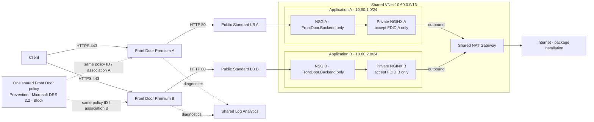

# Example 02: One Front Door Policy, Two Independent Applications

In this Azure example, we deploy two **Front Door Premium profiles**, each delivering its own private NGINX application, and attach one shared **Front Door Web Application Firewall Policy** through **terraform-az-fk-frontdoor v0.1.0**.

This is a complete, independent mini-architecture. It needs no existing origin or Resource Group. The root module still creates only the Front Door policy: delivery and security associations belong to the pinned sibling module.

---

## 🧭 Architecture Overview



*Figure 1. Two independent application delivery paths share one Front Door policy by ID. Dotted arrows represent configuration or diagnostics, not application traffic.*

The lab creates one Resource Group, one global Front Door policy, two Premium profiles/endpoints/security associations, two public Standard Load Balancers, two private VMs with separate disposable SSH keys, two backend subnets/NSGs, one NAT Gateway and one Log Analytics workspace.

Each association protects its own default endpoint with `/*`. Both profiles and the shared policy use `Premium_AzureFrontDoor`. They are in the same subscription, as required by the [Front Door policy FAQ](https://learn.microsoft.com/en-us/azure/web-application-firewall/afds/waf-faq). Managed rules require Premium.

Origins combine the `AzureFrontDoor.Backend` service tag with an application-specific `X-Azure-FDID` check, following [Microsoft's origin-security guidance](https://learn.microsoft.com/en-us/azure/frontdoor/origin-security). NGINX A does not accept profile B's identifier, or vice versa. Sharing security configuration does not share origin authorization.

| Source | Destination | Protocol/port | Expected path and control |
|---|---|---|---|
| Client | Endpoint A or B | HTTPS/443 | Corresponding Front Door profile; shared Prevention policy |
| Front Door A or B | Corresponding NGINX | HTTP/80 | Its public LB → subnet NSG → matching FDID check |
| Azure Load Balancer | Its VM health listener | HTTP/8080 | NSG allows `AzureLoadBalancer`; `/health` needs no FDID |
| Private VMs | Package repositories | TCP/80,443 | Azure system routes and shared NAT Gateway |
| Internet / other backend subnet | NGINX application listener | TCP/80 | Denied by NSG; no inbound SSH |
| Wrong or missing profile identifier | Local NGINX listener | HTTP/80 | Rejected with 403 by NGINX |

Azure-provided DNS resolves package repositories; endpoint DNS is managed by Front Door. There are no UDRs, peering, Private Endpoints, gateways, Application Gateway policies or Azure Firewall resources. Responses to inbound LB flows use the LB return path; NAT provides new outbound connections, not application ingress. Management uses Azure Run Command.

Client-to-edge traffic is HTTPS; edge-to-origin traffic is HTTP for this educational lab, not production end-to-end TLS. Port 8080 has no public LB rule. Default outbound NSG rules are retained for VM bootstrap and Azure management.

---

## 🎯 Why this example exists

Example 01 demonstrates enforcement on one application. This example demonstrates **central Front Door policy governance across two independently configured delivery profiles**.

- One policy ID is consumed twice; there is no duplicated Front Door policy.
- Profiles, routes, origins and associations stay in the Front Door sibling.
- Separate responses identify which application handled a request.
- Shared diagnostics allow comparison without merging origin trust boundaries.
- A policy change affects both applications: review its shared blast radius before tuning.

The root policy module creates neither Front Door delivery resources nor associations. This lab composes focused modules directly; it is not a landing-zone blueprint or orchestrator.

Pinned modules, re-verified live on October 9, 2026:

| Module | Tag |
|---|---|
| [Front Door](https://github.com/foggykitchen/terraform-az-fk-frontdoor/tree/v0.1.0) | v0.1.0 |
| [VNet](https://github.com/foggykitchen/terraform-az-fk-vnet/tree/v0.1.2) | v0.1.2 |
| [NSG](https://github.com/foggykitchen/terraform-az-fk-nsg/tree/v1.0.1) | v1.0.1 |
| [NAT Gateway](https://github.com/foggykitchen/terraform-az-fk-natgw/tree/v1.1.1) | v1.1.1 |
| [Load Balancer](https://github.com/foggykitchen/terraform-az-fk-loadbalancer/tree/v1.2.1) | v1.2.1 |
| [Compute](https://github.com/foggykitchen/terraform-az-fk-compute/tree/v0.4.1) | v0.4.1 |
| [Log Analytics](https://github.com/foggykitchen/terraform-az-fk-log-analytics/tree/v1.0.0) | v1.0.0 |

Configuration is split into `frontdoor_policy.tf`, `frontdoor.tf`, `applications.tf`, `resource_group.tf`, `networks.tf`, `nsg.tf`, `nat_gateway.tf`, `loadbalancers.tf`, `compute.tf`, `tls.tf` and `log_analytics.tf`. The cloud-init template installs and configures the applications.

---

## 🚀 Deployment Steps

Prerequisites: OpenTofu, Azure CLI authentication and permissions, and `curl`/`jq` for tests. The two Premium profiles, NAT Gateway, public IPs, VMs and diagnostics are billable.

```bash
cp terraform.tfvars.example terraform.tfvars
# Edit subscription_id and both globally unique endpoint_names.
tofu fmt -check
tofu init
tofu validate
```

Use a dedicated, absent Resource Group; this configuration creates it. Credentials stay external. The fixed subnet prefixes do not overlap. If composing with existing networks, review address overlap first.

### First deployment: policy bootstrap

The pinned [Front Door v0.1.0 source](https://github.com/foggykitchen/terraform-az-fk-frontdoor/blob/v0.1.0/main.tf) uses `count = var.frontdoor_firewall_policy_id == null ? 0 : 1` for its association. A newly created policy ID is unknown during the first full plan, so that plan can fail with `Invalid count argument`. Static validation cannot detect this.

As in example 01, create the policy first so its ID is known:

```bash
tofu plan -target=module.frontdoor_policy
tofu apply -target=module.frontdoor_policy
tofu plan
tofu apply
```

This is a one-time compatibility workaround, not routine targeted deployment. It creates the Resource Group dependency too. Subsequent changes use normal full plans/applies. No sibling source is modified.

Front Door deployment and global propagation take time. Transient 404 responses immediately after provisioning are not proof of broken routing. Wait and inspect profile, endpoint, route and probe states before changing configuration. [Microsoft's FAQ](https://learn.microsoft.com/en-us/azure/frontdoor/front-door-faq) describes approximately 15 minutes for individual changes and about 30 minutes for back-to-back changes. Example 01 demonstrated this delay in practice. Diagnostic ingestion can also lag.

---

## 🖼️ Azure Portal View

No lab 02 runtime screenshots exist yet. Collect real evidence after an approved deployment; then embed each image with `Figure X. Description`, continuing after Figure 1.

| Figure | Planned filename | Evidence |
|---|---|---|
| 2 | `02_policy_attached_to_frontdoor_resource_group_overview.jpg` | Two profiles, two application backends, one Front Door policy |
| 3 | `02_policy_attached_to_frontdoor_policy_overview.jpg` | Enabled Premium Prevention policy |
| 4 | `02_policy_attached_to_frontdoor_managed_rules.jpg` | Microsoft DRS 2.2 and Block |
| 5 | `02_policy_attached_to_frontdoor_security_policy_a.jpg` | Profile A association and shared policy ID |
| 6 | `02_policy_attached_to_frontdoor_security_policy_b.jpg` | Profile B association and the same policy ID |
| 7 | `02_policy_attached_to_frontdoor_origins_a.jpg` | A's own LB origin and healthy probe |
| 8 | `02_policy_attached_to_frontdoor_origins_b.jpg` | B's distinct LB origin and healthy probe |
| 9 | `02_policy_attached_to_frontdoor_network_security.jpg` | Separate subnets/NSGs, Front Door and LB-probe rules |
| 10 | `02_policy_attached_to_frontdoor_benign_requests.jpg` | HTTP 200 and distinct application A/B responses |
| 11 | `02_policy_attached_to_frontdoor_blocked_requests.jpg` | Controlled XSS HTTP 403 on both endpoints |
| 12 | `02_policy_attached_to_frontdoor_managed_rule_logs.jpg` | Correlated rule Block for each profile |
| 13 | `02_policy_attached_to_frontdoor_origin_protection.jpg` | Direct-origin timeouts and cross-FDID 403 |
| 14 | `02_policy_attached_to_frontdoor_origin_access_logs.jpg` | Benign marker present; blocked marker absent on each VM |

Redact unrelated resources and identifiers where appropriate. Screenshots supplement actual command outputs and correlated diagnostics; they do not replace them.

---

## ✅ Test Results

Static verification of the expanded lab passed on October 9, 2026 with OpenTofu 1.11.6, AzureRM 4.81.0, TLS 4.4.1 and the compute module's Null 3.3.2 dependency:

- `tofu fmt -check`: passed
- `tofu init -backend=false -no-color`: passed; real pinned sibling modules downloaded
- `tofu validate -no-color`: passed, including both Front Door module instances and their association contracts

**No plan, apply or runtime test has been performed for this expanded example.** The following are acceptance tests, not claimed results.

### 1. Verify the shared attachment

```bash
RG="$(tofu output -raw resource_group_name)"
POLICY_ID="$(tofu output -raw frontdoor_firewall_policy_id)"
APPS="$(tofu output -json applications)"
for app in a b; do
  PROFILE="$(printf '%s' "$APPS" | jq -r --arg app "$app" '.[$app].profile_name')"
  az afd security-policy show --resource-group "$RG" --profile-name "$PROFILE" \
    --security-policy-name "shared-policy-$app" \
    --query '{policy:parameters.wafPolicy.id,associations:parameters.associations}' -o json
done
printf 'Expected identical policy ID: %s\n' "$POLICY_ID"
```

Both associations must reference `POLICY_ID`, protect their own endpoint with `/*`, and use Premium profiles. Verify neither application's origin points to the other LB.

### 2. Benign and controlled XSS requests

Run only against these lab endpoints. Use unique markers to distinguish requests from probes and earlier tests.

```bash
MARKER="fk-shared-$(date -u +%Y%m%dT%H%M%SZ)"
for app in a b; do
  HOST="$(printf '%s' "$APPS" | jq -r --arg app "$app" '.[$app].endpoint_host_name')"
  curl --silent --show-error --include --max-time 30 \
    "https://$HOST/search?marker=$MARKER-$app-benign"
  curl --silent --show-error --include --max-time 30 --get \
    --data-urlencode "marker=$MARKER-$app-xss" \
    --data-urlencode 'q=<script>alert(1)</script>' "https://$HOST/search"
done
```

Expect benign HTTP 200 with the corresponding application identity; XSS should return 403. Record UTC timestamps and `X-Azure-Ref` values for both blocked requests. NGINX does not reflect or execute the input.

In Log Analytics, correlate each tracking reference with its own profile and a managed-rule **Block**, not only anomaly-scoring entries. A 403 alone could come from NGINX rather than the Front Door policy.

```kusto
AzureDiagnostics
| where TimeGenerated > ago(1h)
| where Category == "FrontDoorWebApplicationFirewallLog"
| extend Evidence = tostring(pack_all())
| where Evidence contains "<X-Azure-Ref from application A or B>"
| project TimeGenerated, _ResourceId, Evidence
| order by TimeGenerated asc
```

Run for each actual tracking reference. Check that `_ResourceId` matches the corresponding profile, rule details identify Microsoft DRS 2.2, and the final action is Block. Repeat after ingestion delay if necessary. VM guest logs are not automatically collected into this workspace.

### 3. Direct-origin and profile-identity boundaries

```bash
for app in a b; do
  IP="$(printf '%s' "$APPS" | jq -r --arg app "$app" '.[$app].origin_public_ip')"
  curl --silent --show-error --include --connect-timeout 5 --max-time 10 "http://$IP/"
done
```

Expect timeouts (typically curl exit 28), not a working application. Do not loosen the NSGs to obtain an HTTP response.

Use Azure Run Command to isolate application header checks from network filtering:

```bash
for app in a b; do
  other=a
  if [ "$app" = a ]; then other=b; fi
  VM="$(printf '%s' "$APPS" | jq -r --arg app "$app" '.[$app].vm_name')"
  OWN="$(printf '%s' "$APPS" | jq -r --arg app "$app" '.[$app].frontdoor_id')"
  OTHER="$(printf '%s' "$APPS" | jq -r --arg app "$other" '.[$app].frontdoor_id')"
  az vm run-command invoke --resource-group "$RG" --name "$VM" --command-id RunShellScript \
    --scripts "cloud-init status --wait; nginx -t; \
curl -s -o /dev/null -w 'own=%{http_code}\\n' -H 'X-Azure-FDID: $OWN' http://127.0.0.1/; \
curl -s -o /dev/null -w 'other=%{http_code}\\n' -H 'X-Azure-FDID: $OTHER' http://127.0.0.1/; \
curl -s -o /dev/null -w 'missing=%{http_code}\\n' http://127.0.0.1/; \
curl -s -o /dev/null -w 'probe=%{http_code}\\n' http://127.0.0.1:8080/health"
done
```

For both VMs expect own=200, other=403, missing=403, probe=200. This proves the local header guard; it is not a live rerouting test through the other profile.

### 4. Verify the blocked request did not reach either origin

```bash
for app in a b; do
  VM="$(printf '%s' "$APPS" | jq -r --arg app "$app" '.[$app].vm_name')"
  az vm run-command invoke --resource-group "$RG" --name "$VM" --command-id RunShellScript \
    --scripts "grep -F '$MARKER-$app-benign' /var/log/nginx/lab-access.log; \
if grep -F '$MARKER-$app-xss' /var/log/nginx/lab-access.log; then echo FAIL-blocked-request-reached-origin; exit 1; else echo PASS-blocked-marker-absent; fi"
done
tofu plan
```

Require a benign-marker entry on its own VM, no blocked-marker entry, matching Front Door diagnostic evidence, and no unexpected changes in the final full plan. Save actual results and screenshots here only after running these checks.

---

## 🧹 Cleanup

```bash
tofu destroy
tofu state list
az group exists --name "$RG"
```

Confirm empty state and Resource Group absence. Front Door deletion can take many minutes; let OpenTofu finish. All resources in this isolated lab are managed here, including both applications and the shared policy. If you attach any external consumers, detach them before deleting the shared Front Door policy.

SSH private keys are stored in local Terraform/OpenTofu state; treat state and backups as sensitive. Never commit state, keys, credentials, plans, lock files or actual tfvars.

---

## 🪪 License

Licensed under the **Universal Permissive License (UPL), Version 1.0**.
See [LICENSE](../../LICENSE) for details.

© 2026 [FoggyKitchen.com](https://foggykitchen.com) - Cloud. Code. Clarity.
