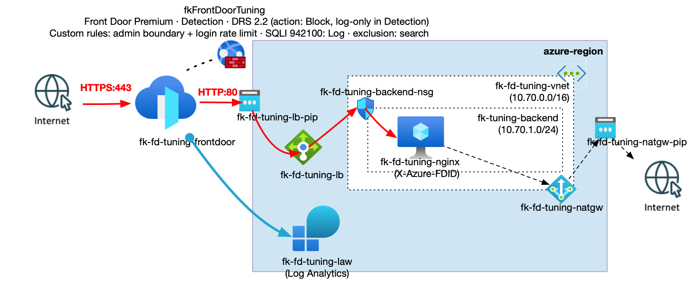
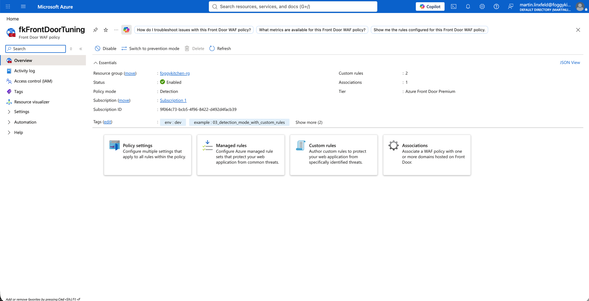
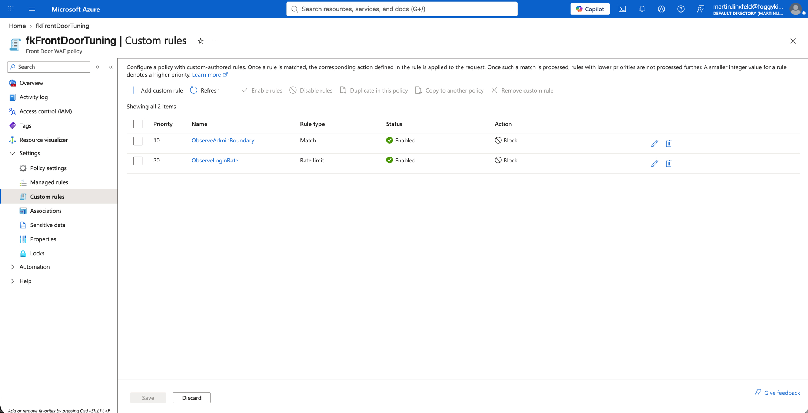
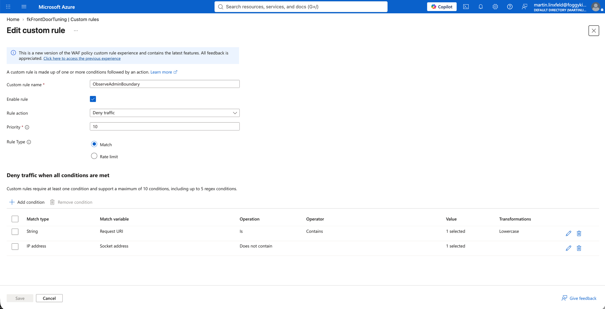
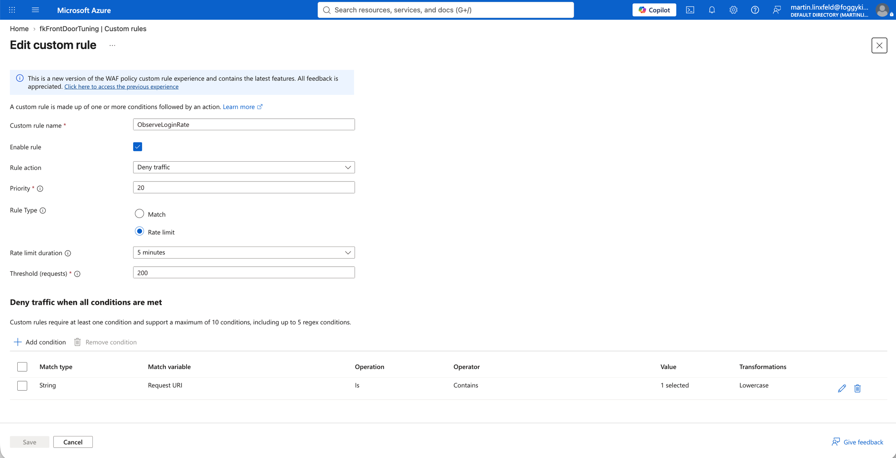
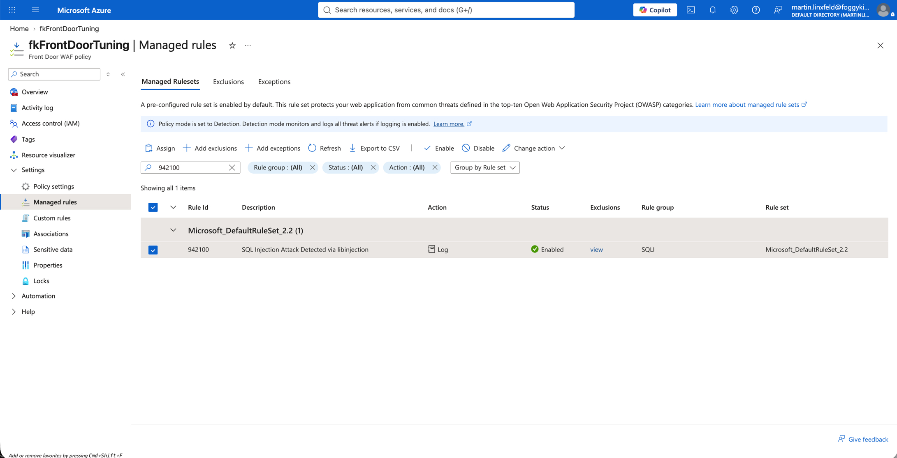
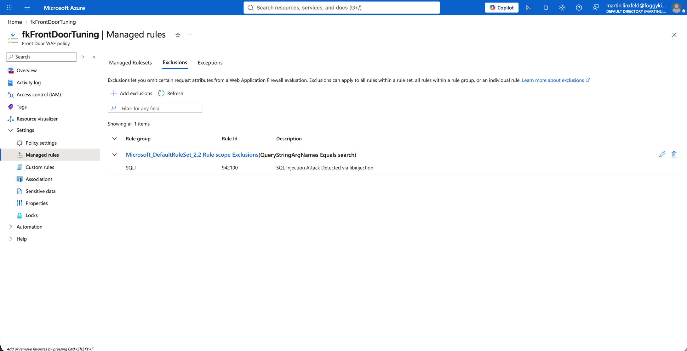
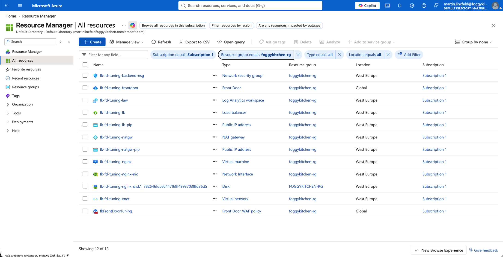

# Example 03: Detection Mode with Custom Rules (Tuning Before Enforcement)

In this Azure Front Door example, we deploy a **complete tuning lab**: a Premium Front Door profile with an independently managed Front Door Web Application Firewall Policy, a public Standard Load Balancer and a private NGINX VM using **Terraform / OpenTofu**.

It extends example 01's delivery architecture with **Detection mode**, custom rules, native rate limiting, a managed-rule override and a narrowly scoped exclusion. This is Front Door protection, not Application Gateway protection or Azure Firewall.

---

## 🧭 Architecture Overview



*Figure 1. One complete delivery path for tuning Front Door protection. The policy observes matching requests in Detection, while the subnet NSG and NGINX profile-ID guard continue to restrict origin access. Front Door diagnostics go to Log Analytics; NGINX request evidence is retrieved through Azure Run Command. The address plan shown uses the default inputs.*

This example creates its own Resource Group and all resources in the diagram:

- One Premium Front Door profile, endpoint, origin group, origin, route and security association through the pinned sibling module.
- One standalone Premium Front Door policy with Microsoft Default Rule Set 2.2 and set action Block.
- `ObserveAdminBoundary`, priority 10: admin-path requests AND a socket IP outside `approved_client_cidrs`; action Block.
- `ObserveLoginRate`, priority 20: login-path RateLimitRule; default 200 requests per socket IP over five minutes; action Block.
- An explicitly enabled SQLI rule 942100 with Log action and a rule-scoped `QueryStringArgNames Equals search` exclusion.
- A public Standard Load Balancer, one private NGINX VM, subnet NSG and NAT Gateway.
- A Log Analytics workspace and profile diagnostic settings.

Detection logs matches without enforcing the configured Block actions. No broad Allow rule bypasses later inspection. Conditions inside each custom rule combine with AND. The lab endpoints are controlled response stubs, not a real login system or SQL database.

| Flow | Path | Boundary / expected behavior |
|---|---|---|
| Client request | HTTPS → Front Door → Load Balancer TCP/80 → NGINX TCP/80 | Policy observes; NSG allows Front Door backend service tag; NGINX requires this profile's FDID |
| Direct origin request | Internet → public Load Balancer TCP/80 | Denied by backend NSG; no direct application response |
| Backend health probe | AzureLoadBalancer → VM TCP/8080 | Only the dedicated health listener is reachable; no public LB rule exposes 8080 |
| VM outbound | Backend subnet → NAT Gateway → Internet | Explicit egress for package bootstrap |
| Diagnostic evidence | Front Door profile → Log Analytics | Front Door access and policy logs; VM access logs remain local |

There is no hub/spoke, peering, custom UDR, Private Link, custom DNS, Application Gateway or Azure Firewall. The VM has no public NIC IP and no inbound SSH rule; use Azure Run Command for management.

### Pinned composition

| Component | Module | Ref |
|---|---|---|
| Front Door delivery and association | terraform-az-fk-frontdoor | v0.1.0 |
| Backend compute | terraform-az-fk-compute | v0.4.1 |
| VNet/subnet | terraform-az-fk-vnet | v0.1.2 |
| Subnet NSG | terraform-az-fk-nsg | v1.0.1 |
| Load Balancer | terraform-az-fk-loadbalancer | v1.2.1 |
| NAT Gateway | terraform-az-fk-natgw | v1.1.1 |
| Log Analytics | terraform-az-fk-log-analytics | v1.0.0 |
| Front Door policy | Local module | ../.. |

---

## 🎯 Why this example exists

Example 01 proves basic Prevention enforcement. Example 03 uses the same complete delivery pattern to answer **which requests match, which control matched, and whether a narrow tuning change leaves other inspection active**.

Separate test paths avoid confusing custom-rule matches with managed-rule evaluation:

- `/health`: benign readiness check.
- `/admin`: approved versus unapproved socket-IP boundary.
- `/login`: bounded request-rate test.
- `/search`: managed-rule observation and excluded `search` versus nonexcluded `q` argument.

A rule-scoped exclusion does not exempt the whole request, other SQLI rules or XSS inspection. Rule 942100 remains Log even if you later change the policy to Prevention. Other managed rules retain their configured/default evaluation.

### Provider Notes

The complete lab uses AzureRM 4.x because Log Analytics v1.0.0 requires it; the declared org-wide range remains `>= 3.100.0, < 5.0.0`. AzureRM 4.81.0 documentation was rechecked for policy mode, native RateLimitRule, SocketAddr, exclusions and explicit rule state/action. The root module's [Provider Notes](../../README.md#provider-notes) document API/schema verification and the DRS 2.2 default.

Sources: [AzureRM 4.81.0 Front Door policy documentation](https://github.com/hashicorp/terraform-provider-azurerm/blob/v4.81.0/website/docs/r/cdn_frontdoor_firewall_policy.html.markdown), [Microsoft: Detection and Prevention](https://learn.microsoft.com/en-us/azure/web-application-firewall/afds/afds-overview), [Front Door rate limiting](https://learn.microsoft.com/en-us/azure/web-application-firewall/afds/waf-front-door-rate-limit), [Front Door exclusions](https://learn.microsoft.com/en-us/azure/web-application-firewall/afds/waf-front-door-exclusion).

Rate counters are distributed across edge servers; do not claim a globally exact cutoff at request 201. Match evidence and observed responses must be recorded rather than inferred from the configured threshold.

---

## 🚀 Deployment Steps

Supply Azure authentication externally. Use a dedicated, disposable Resource Group name and a globally unique endpoint name. Replace the illustrative subscription and approved client CIDRs in the example values; `192.0.2.0/24` is documentation space, not a real approved client.

```bash
cp terraform.tfvars.example terraform.tfvars
tofu fmt -check
tofu init
tofu validate
```

The first deployment requires the same one-time policy bootstrap as examples 01/02. Front Door v0.1.0 decides its association count from the policy ID, which is unknown in an initial full plan. Do not modify the sibling repository or bypass the association:

```bash
tofu plan -target=module.frontdoor_policy -out=bootstrap.tfplan
tofu apply bootstrap.tfplan
tofu plan -out=deployment.tfplan
tofu apply deployment.tfplan
```

Targeting is only a bootstrap workaround; always finish with the full configuration. This sequence was used for the approved October 12 deployment recorded below. A subsequent deployment requires fresh approval and creates billable Premium Front Door, VM, Load Balancer, NAT Gateway and Log Analytics resources.

Wait for cloud-init, origin readiness and Front Door propagation before interpreting HTTP results. Examples 01/02 initially returned 404 during propagation; in example 02 both health endpoints were operational about 25 minutes after apply. Do not loosen security controls to work around startup.

### Optional later enforcement

After reviewing Detection evidence and actual approved socket-IP ranges, change `policy_mode` to `Prevention`, review a full plan and request separate approval before applying it. No second profile is needed.

Expected distinctions: an unapproved admin request is blocked, an approved benign admin request reaches NGINX, XSS is blocked by managed rules, and login rate matches are enforced once edge counters trigger. SQLI 942100's explicit Log override and its exclusion do not automatically become Block. Review that tuning separately.

---

## 🖼️ Azure Portal View

The following actual Portal screenshots were collected after deployment on October 12, 2026. They document configuration, not runtime request behavior.



*Figure 2. fkFrontDoorTuning is Enabled, uses Azure Front Door Premium and runs in Detection mode. The overview reports two custom rules and one association.*



*Figure 3. ObserveAdminBoundary and ObserveLoginRate are Enabled with priorities 10 and 20, respectively. Both have configured Block actions; Detection mode observes rather than enforces those actions.*



*Figure 4. ObserveAdminBoundary is an enabled Match rule at priority 10 with Deny traffic action. Its conditions combine a Request URI Contains match, Lowercase transformation and a negated Socket address condition. The selected URI and IP values are collapsed as “1 selected”; this screenshot does not independently show the literal /admin path or approved CIDR.*



*Figure 5. ObserveLoginRate is an enabled Rate limit rule at priority 20 with Deny traffic action, a five-minute window and threshold of 200 requests. It uses Request URI Contains with Lowercase transformation; the selected /login value is collapsed and is not visible in this image.*



*Figure 6. Rule 942100 in the SQLI group of Microsoft_DefaultRuleSet 2.2 is Enabled with explicit Log action. The Portal also identifies the policy's Detection mode.*



*Figure 7. QueryStringArgNames Equals search is excluded only at rule scope for SQLI rule 942100 in Microsoft_DefaultRuleSet 2.2, rather than for the entire rule group or rule set.*

### Supplemental deployment inventory



*Figure 8. Resource Manager lists the twelve top-level Azure resources in foggykitchen-rg, including the standalone Front Door policy, delivery profile and backend infrastructure. This supplemental inventory is not proof of policy enforcement or traffic delivery; the 28 OpenTofu-managed resources also include child resources, associations and local resources.*

---

## ✅ Test Results

Static verification of the expanded lab completed on October 9, 2026 with OpenTofu 1.11.6, AzureRM 4.81.0, TLS 4.4.1 and Null 3.3.2:

```text
$ tofu fmt -check
(no output; exit 0)

$ tofu init -backend=false -no-color
OpenTofu has been successfully initialized!

$ tofu validate -no-color
Success! The configuration is valid.
```

Deployment completed with explicit approval on October 12, 2026, using the subscription, Resource Group and region from example 01's ignored local tfvars. The endpoint name was made unique to example 03. Actual apply output:

```text
Policy bootstrap:
Apply complete! Resources: 2 added, 0 changed, 0 destroyed.

Full deployment:
Apply complete! Resources: 26 added, 0 changed, 0 destroyed.
```

Total: 28 resources added. Azure read-back confirmed `fkFrontDoorTuning` is Enabled, Premium, Detection and Succeeded. The security association is Succeeded, references this policy ID, and protects the active default endpoint with `/*`.

```text
Resource Group: foggykitchen-rg
Endpoint: fk-fd-tuning-9f064c73-20261012-aeb0ezc4cvecfzaf.z01.azurefd.net
Profile: fk-fd-tuning-frontdoor
VM: fk-fd-tuning-nginx
Private IP: 10.70.1.4
Origin public IP: 40.113.158.154
```

The bootstrap emitted expected targeting/incomplete-apply warnings and was followed by the full apply. The pinned Front Door module emitted a deprecated `metric` warning; no deployment error occurred. The documentary admin CIDR `192.0.2.0/24` is used only for log-only observation, not as a real approved enforcement range.

Resources were destroyed after recording configuration screenshots. Cloud-init readiness, Front Door propagation and runtime policy behavior were not tested before cleanup. The following commands are reproduction/acceptance procedures, not observed traffic-test results; redeploy before running them.

### Readiness and request capture

```bash
RG="$(tofu output -raw resource_group_name)"
HOST="$(tofu output -raw frontdoor_endpoint_host_name)"
VM="$(tofu output -raw nginx_vm_name)"
FDID="$(tofu output -raw frontdoor_resource_guid)"
WORKSPACE="$(tofu output -raw log_analytics_workspace_id)"
MARKER="tuning-$(date +%s)"

az vm run-command invoke --resource-group "$RG" --name "$VM" --command-id RunShellScript \
  --scripts 'cloud-init status --wait; nginx -t; systemctl is-active nginx'
curl -sS -D - "https://$HOST/health?marker=$MARKER-health"
curl -sS -D - "https://$HOST/search?marker=$MARKER-benign"
curl -sS -D - "https://$HOST/admin?marker=$MARKER-admin"
curl -sS -D - --get --data-urlencode 'q=<script>alert(1)</script>' \
  --data-urlencode "marker=$MARKER-xss" "https://$HOST/search"
```

In Detection, require HTTP 200 and `X-FoggyKitchen-Origin: nginx-tuning-lab` for the controlled paths after readiness. Save each `X-Azure-Ref`. Correlate admin traffic from a known unapproved socket IP to `ObserveAdminBoundary`, and XSS to actual DRS matches. Repeat the admin test from a genuinely approved client/egress IP; do not spoof `X-Forwarded-For` as proof of SocketAddr behavior.

### Managed-rule tuning comparison

```bash
curl -sS -D - --get --data-urlencode 'q=1 OR 1=1' \
  --data-urlencode "marker=$MARKER-sqli-q" "https://$HOST/search"
curl -sS -D - --get --data-urlencode 'search=1 OR 1=1' \
  --data-urlencode "marker=$MARKER-sqli-search" "https://$HOST/search"
```

Use these as starting probes, not guaranteed rule fingerprints. First establish an actual 942100 match for the nonexcluded argument, then compare the same payload in `search`. Both requests should reach the origin in Detection. The excluded argument should not cause rule 942100's match, but other rules may still log it. If the baseline does not match, the exclusion test is inconclusive: review the logs and select a controlled payload that does match, rather than claiming a successful exclusion.

### Bounded login rate test

With default values, send a controlled burst of at most 600 requests from the same client socket-IP path:

```bash
for i in $(seq 1 600); do
  curl -sS --connect-timeout 5 --max-time 20 -o /dev/null \
    -w "$i %{http_code}\n" "https://$HOST/login?marker=$MARKER-login-$i" || break
done
```

Record duration and actual counts, and stop on unexpected errors. Detection should permit requests; require actual `ObserveLoginRate` records before declaring the rate test passed. A distributed burst that never produces a match is inconclusive, not proof the policy is broken. Do not run an unbounded load test.

### Diagnostic and origin correlation

```bash
az monitor log-analytics query --workspace "$WORKSPACE" --analytics-query \
"AzureDiagnostics
| where TimeGenerated > ago(2h)
| where Category == 'FrontDoorWebApplicationFirewallLog'
| where requestUri_s contains '$MARKER'
| project TimeGenerated, _ResourceId, action_s, ruleName_s, trackingReference_s
| order by TimeGenerated asc" -o json

az vm run-command invoke --resource-group "$RG" --name "$VM" --command-id RunShellScript \
  --scripts "grep -F '$MARKER' /var/log/nginx/lab-access.log"
```

Allow time for ingestion. Compare exact tracking references and profile resource ID, not only a shared marker or HTTP status. Detection evidence must show both the policy match and delivery to NGINX. Do not label every logged action Block: record the actual action emitted by Azure.

### Origin restrictions remain enforced

```bash
ORIGIN="$(tofu output -raw origin_public_ip)"
curl -sS --connect-timeout 5 --max-time 10 "http://$ORIGIN/health"

az vm run-command invoke --resource-group "$RG" --name "$VM" --command-id RunShellScript \
  --scripts "curl -sS -o /dev/null -w 'own=%{http_code}\n' -H 'X-Azure-FDID: $FDID' http://127.0.0.1/health; \
curl -sS -o /dev/null -w 'missing=%{http_code}\n' http://127.0.0.1/health; \
curl -sS -o /dev/null -w 'wrong=%{http_code}\n' -H 'X-Azure-FDID: 00000000-0000-0000-0000-000000000000' http://127.0.0.1/health; \
curl -sS -o /dev/null -w 'probe=%{http_code}\n' http://127.0.0.1:8080/health"
```

Require direct-origin timeout/no application response, own FDID 200, missing/wrong FDID 403 and local health 200. These local checks do not substitute for Azure LB probe metrics.

Review a final full plan for unexpected changes. Examples 01/02 observed diagnostic destination read-back normalization (`AzureDiagnostics` → null); record any such diff honestly instead of claiming a clean plan. Add actual runtime logs and screenshots only after executing the tests.

---

## 🧹 Cleanup

The approved cleanup completed on October 12, 2026:

```text
Destroy complete! Resources: 28 destroyed.

tofu state list
(empty output)

az group exists --name foggykitchen-rg
false
```

The Front Door profile took 15 minutes 26 seconds to delete. The state is empty and Azure confirmed that the dedicated Resource Group no longer exists. The configuration, architecture diagram and screenshots remain in this repository; infrastructure can be recreated from the configuration with fresh deployment approval.

All deployment resources and the dedicated Resource Group belong to this example:

```bash
RG="$(tofu output -raw resource_group_name)"
tofu destroy
tofu state list
az group exists --name "$RG"
```

Require empty state and Resource Group absence. Let Front Door deletion finish; profile deletion in example 02 took approximately 14–15 minutes. Detach any external consumers before deleting the shared policy if you add them beyond this isolated lab.

Local state and backups contain the generated SSH private key. Never commit state, credentials, keys, plans, lock files or actual tfvars.

---

## 🪪 License

Licensed under the **Universal Permissive License (UPL), Version 1.0**.
See [LICENSE](../../LICENSE) for details.

© 2026 [FoggyKitchen.com](https://foggykitchen.com) - Cloud. Code. Clarity.
