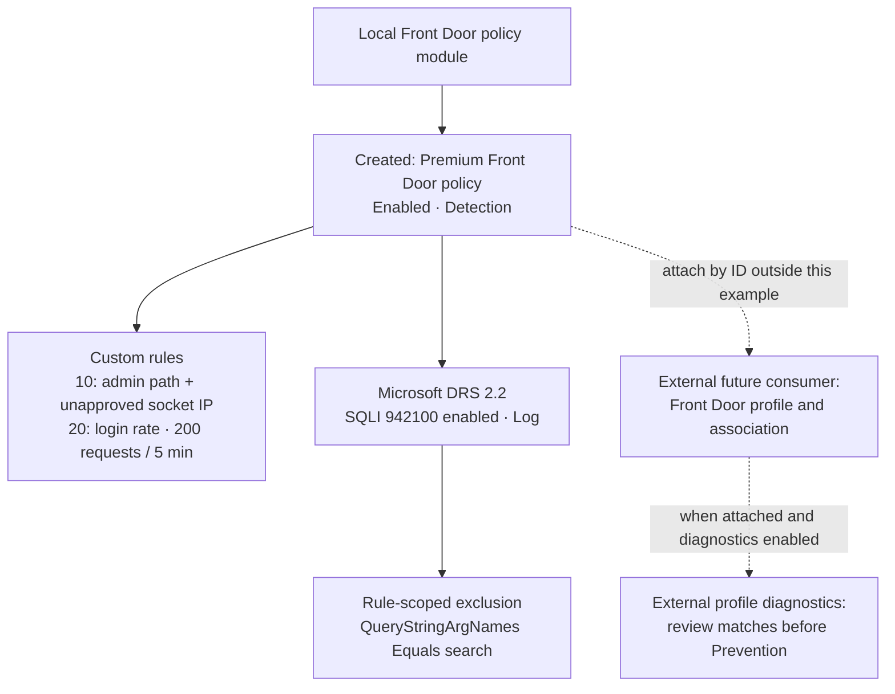

# Example 03: Detection Mode with Custom Rules (Tuning Before Enforcement)

In this Azure Front Door policy example, we configure **Detection mode** with an admin-path IP boundary, a native login rate limit, a managed-rule override and a narrow exclusion using **Terraform / OpenTofu**.

Its purpose is to make potentially disruptive controls reviewable before enforcement. Detection mode logs matching traffic without blocking it, even when a rule action is Block.

---

## 🧭 Architecture Overview

The local module creates one standalone Premium Front Door policy. Its custom rules evaluate before managed rules: an admin-path rule at priority 10 and a login rate limit at priority 20. DRS 2.2 includes an explicit SQLI rule 942100 Log override and a rule-scoped exclusion for the query argument `search`.



*Figure 1. Detection-policy configuration and the external attachment/diagnostics needed for traffic-based tuning. The dotted relationships are not created by this example.*

This example creates:

- One enabled Front Door Premium policy in Detection mode
- Microsoft Default Rule Set 2.2 with the set action Block
- `ObserveAdminBoundary`: Block rule matching admin-path requests from unapproved socket IPs
- `ObserveLoginRate`: native RateLimitRule matching the login path, threshold 200 over five minutes
- An enabled SQLI 942100 override with Log action
- A query-argument exclusion scoped only to that managed rule

The Resource Group already exists. No Front Door profile, association, origin or diagnostic destination is created. The configured rules are not evaluated until an external consumer attaches the policy.

---

## 🎯 Why this example exists

Before enforcing custom boundaries, request-rate controls or managed-rule changes, it is useful to understand **what matches legitimate traffic and how narrowly an exclusion can be scoped**.

This example focuses on:

- Detection-mode observation before Prevention
- A negated-IP Block boundary that avoids a broad Allow bypass
- Native Front Door rate limiting per socket IP
- Explicit rule state when changing a managed rule's action
- A rule-scoped exclusion rather than a set-wide inspection exception

Conditions within a custom rule combine with AND; values within a condition combine with OR. The documentation CIDR `192.0.2.0/24` must be replaced with your actual approved client ranges before enforcement.

---

## 🚀 Deployment Steps

For the static checks already performed:

```bash
cp terraform.tfvars.example terraform.tfvars
tofu fmt -check
tofu init
tofu validate
```

Replace the illustrative subscription ID, existing Resource Group name and approved client CIDRs. Supply Azure authentication externally.

For a later, reviewed deployment:

```bash
tofu plan
tofu apply
```

This deploys only the policy. For traffic-based tuning, attach its output ID to an isolated Premium Front Door profile using the composition demonstrated in example 02, and configure diagnostics on that profile with an externally managed destination. That test attachment is outside this example's configuration.

---

## 🖼️ Azure Portal View

Screenshots have not been collected. After deployment, collect:

| Planned screenshot | Evidence to capture |
|---|---|
| `03_detection_mode_with_custom_rules_resource_group_overview.jpg` | Standalone Front Door policy in the existing Resource Group |
| `03_detection_mode_with_custom_rules_policy_overview.jpg` | Premium SKU, Enabled state and Detection mode |
| `03_detection_mode_with_custom_rules_admin_rule.jpg` | Priority 10, admin path, negated SocketAddr IPMatch and Block action |
| `03_detection_mode_with_custom_rules_rate_limit_rule.jpg` | Priority 20, RateLimitRule, login match, 200-request threshold and five-minute duration |
| `03_detection_mode_with_custom_rules_managed_override.jpg` | DRS 2.2 SQLI 942100 enabled with Log action |
| `03_detection_mode_with_custom_rules_rule_exclusion.jpg` | QueryStringArgNames Equals search scoped to rule 942100 |
| `03_detection_mode_with_custom_rules_detection_logs.jpg` | After a separate test attachment: matching requests logged and permitted |

Redact subscription IDs, real client IPs and sensitive request data. Add image links and figure captions only after collecting real evidence.

---

## ✅ Test Results

Static verification completed on October 9, 2026 with OpenTofu 1.11.6 and AzureRM 4.81.0:

- `tofu fmt -check`: passed
- `tofu init -backend=false -no-color`: passed
- `tofu validate -no-color`: passed

No plan, apply or traffic test was run. The root module additionally validates with AzureRM 3.100.0; this example was validated with 4.81.0.

After a future deployment:

1. Verify the deployed policy is Enabled, Premium and Detection.
2. Inspect both custom-rule priorities, conditions, actions, rate duration and threshold in Azure.
3. Inspect the actual SQLI override state/action and the exact rule-scoped exclusion.
4. Run a post-deployment `tofu plan` and confirm no unexpected changes.
5. Record the configuration evidence and screenshots here.

After a separately managed isolated Front Door attachment with diagnostics:

1. Send benign traffic and confirm it reaches the controlled origin.
2. Exercise the admin path from approved and unapproved client IPs. Confirm only the unapproved condition matches and Detection permits the requests.
3. Generate controlled login requests above the configured threshold from one socket IP. Confirm the rate-limit matches are logged without claiming an exact globally synchronized cutoff; edge counters make rate enforcement approximate.
4. Compare reviewed managed-rule requests with and without the excluded `search` argument. Confirm the exclusion affects rule 942100 only and other inspection remains active.
5. Record HTTP results and correlated diagnostic entries. Diagnose unrelated origin errors separately.
6. Review false positives before a separately approved Prevention-mode test. A Detection deployment cannot prove blocking behavior.

---

## 🧹 Cleanup

Detach any independently created test associations before deleting the policy:

```bash
tofu destroy
```

The existing Resource Group and external diagnostic destination remain managed outside this example. Clean up any separately deployed billable Front Door test profile in its own configuration.

---

## 🪪 License

Licensed under the **Universal Permissive License (UPL), Version 1.0**.
See [LICENSE](../../LICENSE) for details.

© 2026 [FoggyKitchen.com](https://foggykitchen.com) - Cloud. Code. Clarity.
